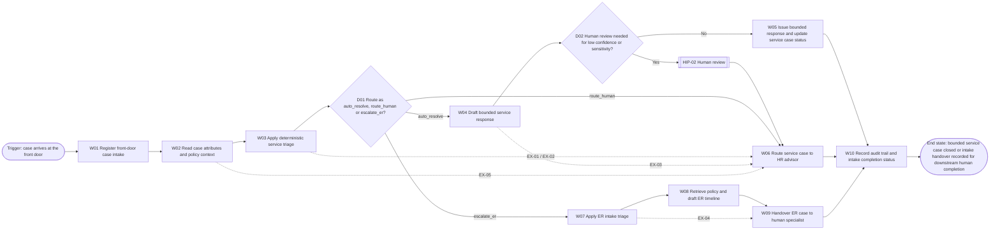
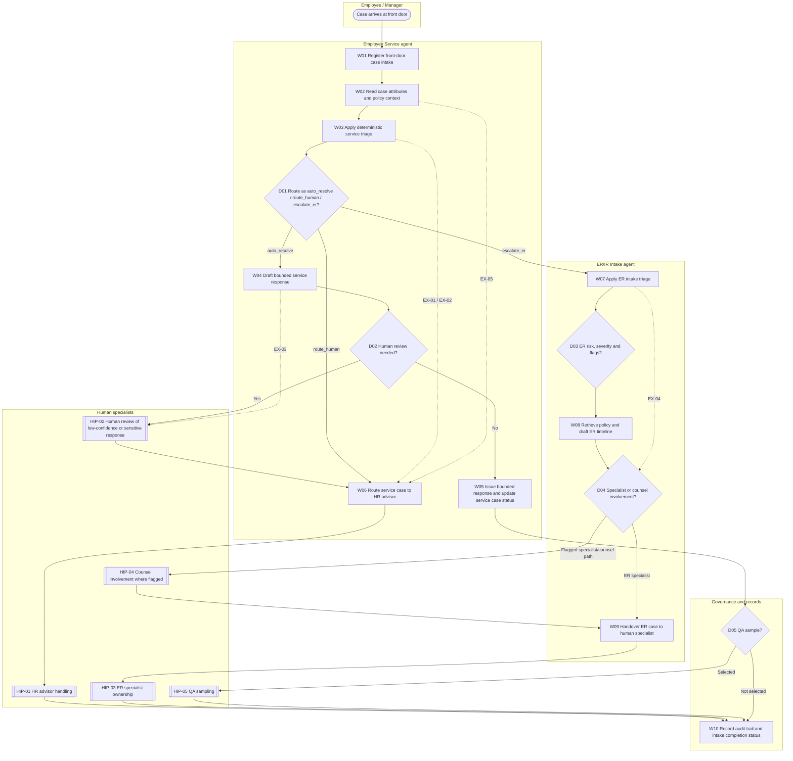

# Employee Service & ER/IR Intake Agent Stage 3 – Decompose

# Document Control

| Control Item | Details | Evidence |
| --- | --- | --- |
| Document title | Employee Service & ER/IR Intake Agent Stage 3 – Decompose | [SRC-01, Final Deliverable Once all Stage 3 artefacts have been generated and validated]; [SRC-02, section 6.4 Employee Service + ER/IR Intake Agents] |
| Business agent ID | `HR-MTS-001/002`; individual mapping remains pending under TBC-06. | [SRC-02, section 6.4 Employee Service + ER/IR Intake Agents]; [SRC-01, Evidence status and pre-generation gaps] |
| Version | Draft v0.1 | [SRC-06, Document Control] |
| Status | Draft for SME review | [SRC-01, Validation]; [SRC-05, section 11.8 Acceptance gate] |
| Prepared by | GitHub Copilot Coding Agent drafting support; named human preparer remains pending under TBC-01. | [SRC-01, repository_context]; [SRC-01, Evidence status and pre-generation gaps] |
| Prepared for | HR SME review, delivery review and Stage 3 governance review. | [SRC-06, Document Control]; [SRC-05, section 12 Completion response] |
| Date | 17 September 2026 | [SRC-01, current_datetime] |
| Classification | KPMG Confidential | [SRC-06, title block] |
| Approval required from | Business SME, Technical / Delivery Lead and Stage 3 Approver; named people and evidence remain pending under TBC-01. | [SRC-06, Review and Approval]; [SRC-01, Evidence status and pre-generation gaps] |
| Review purpose | Confirm that the decomposition accurately reflects the business capability, workflow, decisions, handovers, exceptions and human intervention model without asserting unsupported facts. | [SRC-06, Review purpose]; [SRC-04, section 4 Source approval and evidence rules] |

## Version History

| Version | Date | Author | Summary of Change | Status | Evidence |
| --- | --- | --- | --- | --- | --- |
| 0.1 | 17 September 2026 | GitHub Copilot Coding Agent | Initial evidence-based Stage 3 artefact set for the Employee Service & ER/IR Intake Agent generated for SME review. | Draft | [SRC-01, required artefacts list]; [SRC-01, current_datetime] |

## Review and Approval

| Role | Name | Review / Approval | Date | Evidence / Reference |
| --- | --- | --- | --- | --- |
| Business SME | Pending under TBC-01 | Pending | Pending under TBC-01 | [SRC-01, Evidence status and pre-generation gaps]; [SRC-06, Review and Approval] |
| Technical / Delivery Lead | Pending under TBC-01 | Pending | Pending under TBC-01 | [SRC-01, Evidence status and pre-generation gaps]; [SRC-06, Review and Approval] |
| Stage 3 Approver | Pending under TBC-01 | Pending | Pending under TBC-01 | [SRC-01, Evidence status and pre-generation gaps]; [SRC-06, Review and Approval] |

# Table of Contents

- [1. Executive Summary](#1-executive-summary)
- [2. Stage 3 Activities and Outputs](#2-stage-3-activities-and-outputs)
- [3. Step 1 – Review and Understand the Capability](#3-step-1--review-and-understand-the-capability)
  - [3.1 Capability Summary](#31-capability-summary)
  - [3.2 Capability Boundary](#32-capability-boundary)
  - [3.3 Success Measures](#33-success-measures)
  - [3.4 Assumptions, Constraints and Open Questions](#34-assumptions-constraints-and-open-questions)
- [4. Step 2 – Create the Overall AI Framework](#4-step-2--create-the-overall-ai-framework)
- [5. Step 3 – Map the End-to-End Workflow](#5-step-3--map-the-end-to-end-workflow)
  - [5.1 Workflow Purpose and Scope](#51-workflow-purpose-and-scope)
  - [5.2 High-Level Process Map](#52-high-level-process-map)
  - [5.3 High-Level Workflow Sequence](#53-high-level-workflow-sequence)
- [6. Step 4 – Decompose into Workflow Steps](#6-step-4--decompose-into-workflow-steps)
  - [6.1 Detailed Workflow Diagram](#61-detailed-workflow-diagram)
  - [6.2 Workflow Decomposition Catalogue](#62-workflow-decomposition-catalogue)
- [7. Step 5 – Define Handovers and Interactions](#7-step-5--define-handovers-and-interactions)
  - [7.1 Interface and Dependency Register](#71-interface-and-dependency-register)
- [8. Decisions, Exceptions and Human Intervention Points](#8-decisions-exceptions-and-human-intervention-points)
  - [8.1 Key Decision Points](#81-key-decision-points)
  - [8.2 Exception Catalogue](#82-exception-catalogue)
  - [8.3 Human Intervention Points](#83-human-intervention-points)
- [9. Steps 6 and 7 – SME Validation and Confirmation](#9-steps-6-and-7--sme-validation-and-confirmation)
  - [9.1 SME Walkthrough Checklist](#91-sme-walkthrough-checklist)
  - [9.2 Validation Actions and Resolution Log](#92-validation-actions-and-resolution-log)
  - [9.3 SME Confirmation](#93-sme-confirmation)
- [10. Completion and Quality Checklist](#10-completion-and-quality-checklist)
- [Appendix A – Glossary and Acronyms](#appendix-a--glossary-and-acronyms)
- [Appendix B – Source and Evidence Register](#appendix-b--source-and-evidence-register)
- [Appendix C – Stage 3 to Stage 4 Handover](#appendix-c--stage-3-to-stage-4-handover)

# 1. Executive Summary

This Stage 3 draft decomposes the **Employee Service & ER/IR Intake Agent** for the **Manage Workforce Relations to Experience** value stream and preserves the evidenced objective of **Continuous Workforce Safeguarding**. The approved capability evidence states the client outcome as **lower cost-to-serve; consistent policy; safe, human-led ER handling**. [SRC-02, Part 1 value stream table]

The capability purpose is two-part: the front-door Employee Service scope answers, triages and resolves bounded self-service requests, while the ER/IR Intake scope risk-classifies employee-relations matters, retrieves policy and drafts a timeline. The behaviour chain is evidenced as **Triage → Classify → Route/Resolve → (human for ER) → Close**. [SRC-02, section 5 Manage Workforce Relations to Experience - Continuous Workforce Safeguarding, Purpose]; [SRC-02, section 5 Manage Workforce Relations to Experience - Continuous Workforce Safeguarding]

The autonomy boundary remains tightly controlled. Bounded, policy-covered service requests may be auto-resolved with provenance, while **all ER-stream cases**, **non-standard or high-priority matters** and **low-confidence or sensitive answers** require human handling or review. The deliverable preserves segregation of duties, audit traceability and the rule that a recommendation is not approval. [SRC-01, Evidence and modelling constraints]; [SRC-02, section 4.3 Segregation-of-duties matrix]; [SRC-02, section 4.4 Audit trail schema]; [SRC-02, section 5 Manage Workforce Relations to Experience - Continuous Workforce Safeguarding, Human-in-the-loop boundary]; [SRC-02, section 5 Manage Workforce Relations to Experience - Continuous Workforce Safeguarding, Governance & compliance controls]

The coherent draft workflow begins with a **case arriving at the front door**, then moves through deterministic service triage, bounded service response or human service routing, ER risk classification where required, policy retrieval, human specialist handover and audit-trail recording. The source set is **sufficient with gaps**, not complete: there is no SME walkthrough evidence, no named approvers, no detailed client-specific rule matrix, no named ownership model, no confirmed split of `HR-MTS-001/002`, and no evidenced closure criteria for human-routed cases. The document status therefore remains **Draft for SME review** and must not be presented as Stage 3 complete. [SRC-01, Evidence status and pre-generation gaps]; [SRC-02, section 5 Manage Workforce Relations to Experience - Continuous Workforce Safeguarding, Use case]; [SRC-02, section 6.4 Employee Service + ER/IR Intake Agents, Generic agent script]; [SRC-05, section 6 Sufficiency assessment]

# 2. Stage 3 Activities and Outputs

| Step | Activity | Capability-specific output / evidence | Source evidence |
| --- | --- | --- | --- |
| 1 | Review and understand the capability | Capability summary, boundary, measures and controlled ACO/TBC registers for the Employee Service & ER/IR Intake scope. | [SRC-03, Stage 3 activities]; [SRC-02, section 5 Manage Workforce Relations to Experience - Continuous Workforce Safeguarding]; [SRC-02, section 6.4 Employee Service + ER/IR Intake Agents] |
| 2 | Create the Overall AI Framework | Logical framework covering purpose, users, inputs, outputs, systems, controls, compliance and guardrails. | [SRC-03, Stage 3 activities]; [SRC-04, section 6 Expected outputs] |
| 3 | Map the end-to-end workflow | High-level process map from front-door case intake to bounded resolution or human-owned handover. | [SRC-03, Stage 3 activities]; [SRC-02, section 5 Manage Workforce Relations to Experience - Continuous Workforce Safeguarding, Use case]; [SRC-02, section 6.4 Employee Service + ER/IR Intake Agents, Generic agent script] |
| 4 | Decompose into workflow steps | W01-W10 decomposition with performers, data operations, decisions, exceptions and evidence. | [SRC-03, Stage 3 activities]; [SRC-05, section 9.7 Workflow Decomposition Catalogue] |
| 5 | Define handovers and interactions | H01-H08 handovers and DEP-01-DEP-07 dependencies with logical interfaces only. | [SRC-03, Stage 3 activities]; [SRC-05, section 9.8 Handover and Interaction Register] |
| 6 | Validate with SME | Walkthrough checklist and validation actions prepared; no SME walkthrough evidence supplied. | [SRC-03, Stage 3 activities]; [SRC-01, Evidence status and pre-generation gaps]; [SRC-05, section 9.12 SME Validation and Confirmation] |
| 7 | Obtain SME confirmation | Confirmation section retained as pending; approval is not claimed. | [SRC-03, Stage 3 activities]; [SRC-05, section 11.8 Acceptance gate] |

# 3. Step 1 – Review and Understand the Capability

## 3.1 Capability Summary

| Area | Definition | Evidence |
| --- | --- | --- |
| Business capability | Employee Service & Case Resolution supporting Continuous Workforce Safeguarding. | [SRC-02, Part 1 value stream table]; [SRC-02, section 6.4 Employee Service + ER/IR Intake Agents] |
| Business outcome | Lower cost-to-serve; consistent policy; safe, human-led ER handling. | [SRC-02, Part 1 value stream table] |
| Business agent name | Employee Service & ER/IR Intake Agent. | [SRC-01, Final Deliverable Once all Stage 3 artefacts have been generated and validated]; [SRC-02, section 5 Manage Workforce Relations to Experience - Continuous Workforce Safeguarding] |
| Agent ID | Combined identifier `HR-MTS-001/002`; mapping remains open under TBC-06. | [SRC-02, section 6.4 Employee Service + ER/IR Intake Agents]; [SRC-01, Evidence status and pre-generation gaps] |
| Owner labels evidenced | HR Operations / ER Specialist owner persona in the value-stream build specification and agent registry; HR Operations only in the detailed agent card. No finer ownership split is evidenced. | [SRC-02, section 4.2 Agent registry]; [SRC-02, section 5 Manage Workforce Relations to Experience - Continuous Workforce Safeguarding]; [SRC-02, section 6.4 Employee Service + ER/IR Intake Agents] |
| Primary users and performers | Employees and managers raise cases; HR advisor, HR Operations and ER Specialist provide human handling where required. | [SRC-02, section 5 Manage Workforce Relations to Experience - Continuous Workforce Safeguarding, Inputs]; [SRC-02, section 5 Manage Workforce Relations to Experience - Continuous Workforce Safeguarding, Human-in-the-loop boundary] |
| Autonomy level | L3 – Augmented+; bounded self-service may be auto-resolved, while ER and non-standard matters go to a human. | [SRC-02, section 6.4 Employee Service + ER/IR Intake Agents]; [SRC-02, section 5 Manage Workforce Relations to Experience - Continuous Workforce Safeguarding, Human-in-the-loop boundary] |
| Primary purpose | Be the employee and manager front door, answer, triage and resolve bounded self-service requests, and route sensitive matters safely to a human specialist. | [SRC-02, section 5 Manage Workforce Relations to Experience - Continuous Workforce Safeguarding, Purpose] |
| Trigger | A case arriving at the front door. | [SRC-02, section 5 Manage Workforce Relations to Experience - Continuous Workforce Safeguarding, Use case]; [SRC-02, section 6.4 Employee Service + ER/IR Intake Agents, Generic agent script] |
| Supported end state | Auto-resolved bounded service case closed with provenance, or human-routed service/ER case handed over with intake status recorded; full downstream closure remains open under TBC-07. | [SRC-02, section 6.4 Employee Service + ER/IR Intake Agents, Generic agent script]; [SRC-01, Evidence status and pre-generation gaps] |
| Behaviour chain | Triage → Classify → Route/Resolve → (human for ER) → Close. | [SRC-02, section 5 Manage Workforce Relations to Experience - Continuous Workforce Safeguarding] |

## 3.2 Capability Boundary

| Boundary Type | Definition | Evidence |
| --- | --- | --- |
| In scope | Front-door case intake, deterministic service triage, bounded self-service response drafting, human service routing, ER intake triage, policy retrieval, draft timeline creation, human specialist handover, provenance and audit-trail recording. | [SRC-02, section 5 Manage Workforce Relations to Experience - Continuous Workforce Safeguarding, Purpose]; [SRC-02, section 5 Manage Workforce Relations to Experience - Continuous Workforce Safeguarding, Use case]; [SRC-02, section 6.4 Employee Service + ER/IR Intake Agents, Generic agent script] |
| Out of scope | ER determinations by the agent, autonomous action on ER cases, unsupported non-standard service resolution, client-specific rule values, technical design, Stage 4 classification and deployment decisions. | [SRC-01, Evidence and modelling constraints]; [SRC-02, section 5 Manage Workforce Relations to Experience - Continuous Workforce Safeguarding, Human-in-the-loop boundary]; [SRC-04, section 14 Stage boundary] |
| Autonomy boundary | The agent may triage, draft bounded responses, classify ER risk, retrieve policy, draft timelines and route work. Consequential human service handling and all ER outcomes remain human-led. | [SRC-02, section 2 Design principle - deterministic core / LLM boundary]; [SRC-02, section 5 Manage Workforce Relations to Experience - Continuous Workforce Safeguarding, Human-in-the-loop boundary]; [SRC-02, section 6.4 Employee Service + ER/IR Intake Agents] |
| Mandatory guardrails | ER cases never auto-actioned; provenance on every answer; human review of low-confidence or sensitive matters; QA sampling of auto-resolved cases; segregation of duties; audit trail. | [SRC-01, Evidence and modelling constraints]; [SRC-02, section 4.3 Segregation-of-duties matrix]; [SRC-02, section 4.4 Audit trail schema]; [SRC-02, section 5 Manage Workforce Relations to Experience - Continuous Workforce Safeguarding, Governance & compliance controls] |
| Dependencies | HR knowledge base, case system, ER system, policy and law sources, HR advisor workflow, ER specialist or counsel workflow, and governance logging. | [SRC-02, section 6.4 Employee Service + ER/IR Intake Agents, Systems of record]; [SRC-02, section 7 Agent collaboration matrix]; [SRC-02, section 4.1 Cross-agent communication] |

## 3.3 Success Measures

| ID | Measure | Baseline | Target | Method / evidence | Owner | Evidence |
| --- | --- | --- | --- | --- | --- | --- |
| SM-01 | Containment/deflection rate and first-contact resolution. | Not evidenced (see TBC-02). | Not evidenced. | Use case and evaluation framework identify these as relevant measures, but no baseline or target values are supplied. | Measurement owner pending under TBC-02. | [SRC-02, section 5 Manage Workforce Relations to Experience - Continuous Workforce Safeguarding, Evaluation criteria] |
| SM-02 | Reopen rate. | Not evidenced (see TBC-02). | Not evidenced. | Relevant as a service-quality measure, but no source-stated threshold or owner is supplied. | Measurement owner pending under TBC-02. | [SRC-02, section 5 Manage Workforce Relations to Experience - Continuous Workforce Safeguarding, Evaluation criteria] |
| SM-03 | ER routing precision. | Not evidenced (see TBC-02). | Zero ER cases auto-resolved. | Supported by the evaluation criteria and the human-led ER boundary. | Measurement owner pending under TBC-02. | [SRC-02, section 5 Manage Workforce Relations to Experience - Continuous Workforce Safeguarding, Evaluation criteria]; [SRC-01, Evidence status and pre-generation gaps] |
| SM-04 | Grounding/faithfulness score on drafted responses. | Not evidenced (see TBC-02). | Not evidenced. | The source requires grounded, cited narration and faithfulness evaluation but does not supply a numeric target. | Measurement owner pending under TBC-02. | [SRC-02, section 4.6 Evaluation framework by component type]; [SRC-02, section 5 Manage Workforce Relations to Experience - Continuous Workforce Safeguarding, Evaluation criteria] |

## 3.4 Assumptions, Constraints and Open Questions

### ACO register

| ID | Type | Description | Impact | Owner | Resolution action | Status / due date | Affected sections | Evidence |
| --- | --- | --- | --- | --- | --- | --- | --- | --- |
| ACO-01 | Missing information | No SME walkthrough record, confirmation evidence, approver names, approval dates or approval artefacts were supplied. | The deliverable cannot claim SME validation, review-ready acceptance or Stage 3 completion. | Ownership assignment pending; proposed resolution owner – Stage 3 Approver / capability SME once named (see TBC-01). | Capture named SME and approver records, walkthrough notes, decisions, dates and approval evidence. | Open; due date pending. | Document Control; Review and Approval; Step 6 and 7; Completion and Quality Checklist; 09 Validation report. | [SRC-01, Evidence status and pre-generation gaps]; [SRC-05, section 9.12 SME Validation and Confirmation] |
| ACO-02 | Missing information | No evidenced measure baselines or targets were supplied beyond qualitative evaluation measures and the explicit rule that zero ER cases are auto-resolved. | Success measures can be listed, but most baselines, targets, owners and methods remain provisional and unsuitable for sign-off. | Ownership assignment pending; proposed resolution owner – HR Operations / ER Specialist measurement owner once named. | Agree measure definitions, baselines, targets, reporting periods and named measurement owners. | Open; due date pending. | Step 1 success measures; Step 2 Overall AI Framework; Step 6 and 7; Appendix C. | [SRC-01, Evidence status and pre-generation gaps]; [SRC-02, section 4.6 Evaluation framework by component type]; [SRC-02, section 5 Manage Workforce Relations to Experience - Continuous Workforce Safeguarding, Evaluation criteria] |
| ACO-03 | Missing information | No detailed client-specific policy catalogue, category/priority/SLA rule matrix, retention schedule or escalation timing evidence was supplied. | Triage, response, retention and escalation logic can be represented only at logical level; no client-specific rule values, timing or retention periods may be asserted. | Ownership assignment pending; proposed resolution owner – HR Operations policy owner once named. | Provide the approved policy library, rule matrix, retention schedule and escalation timing artefacts. | Open; due date pending. | Capability boundary; workflow catalogue; handover register; interface/dependency register; decisions; exceptions; Appendix C. | [SRC-01, Evidence status and pre-generation gaps]; [SRC-02, section 5 Manage Workforce Relations to Experience - Continuous Workforce Safeguarding, Deterministic calculation requirements]; [SRC-02, section 4.4 Audit trail schema] |
| ACO-04 | Missing information | No named data owners, data stewards, source-system owners or control owners were supplied; only generic owner personas appear in source evidence. | Ownership categories required by Stage 3 cannot be fully normalised without inventing accountability. | Ownership assignment pending; proposed resolution owner – capability governance lead once named. | Assign and evidence business owner, data owner, data steward, source-system owner and control owner roles separately. | Open; due date pending. | Capability record; Overall AI Framework; interface/dependency register; human intervention points; validation actions; Appendix C. | [SRC-01, Evidence status and pre-generation gaps]; [SRC-04, section 8 Ownership terminology]; [SRC-02, section 4.2 Agent registry]; [SRC-02, section 6.4 Employee Service + ER/IR Intake Agents] |
| ACO-05 | Open question | The approved combined agent identifier `HR-MTS-001/002` does not evidence which ID maps to Employee Service versus ER/IR Intake. | The deliverable must preserve the combined identifier and cannot split it into separate approved agent records. | Ownership assignment pending; proposed resolution owner – Stage 2 capability approver once named. | Confirm and document the approved mapping of `HR-MTS-001` and `HR-MTS-002` to the respective agent scopes. | Open; due date pending. | Document Control; Capability summary; source register; Stage 3 to Stage 4 handover. | [SRC-01, Evidence status and pre-generation gaps]; [SRC-02, section 6.4 Employee Service + ER/IR Intake Agents] |
| ACO-06 | Open question | The supported trigger is only “case at front door”; precise operational closure criteria and the handling or completion model for human-routed cases require SME confirmation. | The workflow can model intake completion and human handover, but not full downstream closure semantics for routed cases. | Ownership assignment pending; proposed resolution owner – HR Operations / ER Specialist process SME once named. | Confirm closure criteria, ownership transitions and how human-routed service and ER cases are marked complete. | Open; due date pending. | Capability summary; workflow sequence; workflow catalogue; exceptions; human intervention points; validation report; Appendix C. | [SRC-01, Evidence status and pre-generation gaps]; [SRC-02, section 6.4 Employee Service + ER/IR Intake Agents, Generic agent script]; [SRC-02, section 5 Manage Workforce Relations to Experience - Continuous Workforce Safeguarding, Use case] |
| ACO-07 | Constraint | Technical owner, model and deployment are explicitly unresolved and must not be designed in Stage 3. | Later-stage technical decisions must be carried forward without solution design or implementation detail being introduced here. | Ownership assignment pending; proposed resolution owner – Delivery Lead once named. | Carry the unresolved technical accountability, model-selection and deployment decisions into Stage 4 onward without resolving them in Stage 3. | Open; due date pending. | Capability summary; Overall AI Framework; interface/dependency register; Step 6 and 7; Appendix C. | [SRC-01, Evidence status and pre-generation gaps]; [SRC-02, section 6.4 Employee Service + ER/IR Intake Agents] |
| ACO-08 | Missing information | No current-state SME walkthrough, SOP, workshop transcript or process map was supplied beyond the approved capability catalogue. | The decomposition remains an evidence-based candidate workflow for review rather than a confirmed current-state operating model. | Ownership assignment pending; proposed resolution owner – capability SME once named. | Validate the candidate workflow with SMEs and update any unsupported decomposition logic. | Open; due date pending. | Stage 3 workflow sections; decisions; exceptions; handovers; validation actions. | [SRC-05, section 6 Sufficiency assessment]; [SRC-01, Evidence status and pre-generation gaps] |
| ACO-09 | Constraint | Only logical systems of record and case-routing interactions are evidenced; interface channels, availability, frequency and named owners are not. | Dependencies must remain business-level and technology-agnostic in Stage 3. | Ownership assignment pending; proposed resolution owner – Delivery Lead and source-system owners once named. | Capture client-specific system, interface and ownership evidence in later design stages after SME confirmation. | Open; due date pending. | Overall AI Framework; handover register; interface/dependency register; Appendix C. | [SRC-02, section 6.4 Employee Service + ER/IR Intake Agents, Systems of record]; [SRC-02, section 7 Agent collaboration matrix]; [SRC-04, section 14 Stage boundary] |

### TBC register

| ID | Description | Impact | Owner | Resolution action | Status / due date | Affected sections | Evidence |
| --- | --- | --- | --- | --- | --- | --- | --- |
| TBC-01 | Named SME, approver, reviewer and approval evidence records are pending. | Document-control and approval tables remain incomplete. | Ownership assignment pending; proposed resolution owner – Stage 3 Approver once named. | Add named people, dates and evidence links after the SME walkthrough. | Open; due date pending. | Document Control; Review and Approval; Step 6 and 7; 09 Validation report. | [SRC-01, Evidence status and pre-generation gaps]; [SRC-06, Review and Approval] |
| TBC-02 | Success-measure baselines, targets, periods and named owners are pending except for zero ER cases auto-resolved. | Most success measures remain qualitative or partially specified. | Ownership assignment pending; proposed resolution owner – measurement owner once named. | Confirm baselines, targets, periods and metric owners. | Open; due date pending. | Step 1 success measures; Step 2 Overall AI Framework; 09 Validation report. | [SRC-01, Evidence status and pre-generation gaps]; [SRC-02, section 5 Manage Workforce Relations to Experience - Continuous Workforce Safeguarding, Evaluation criteria] |
| TBC-03 | Client-specific policy catalogue and category/priority/SLA rule matrix are pending. | Triage logic cannot include client-specific categories, thresholds or SLA values. | Ownership assignment pending; proposed resolution owner – HR Operations policy owner once named. | Provide approved policy and triage rule artefacts. | Open; due date pending. | Workflow catalogue; decision catalogue; interface/dependency register. | [SRC-01, Evidence status and pre-generation gaps]; [SRC-02, section 5 Manage Workforce Relations to Experience - Continuous Workforce Safeguarding, Deterministic calculation requirements] |
| TBC-04 | Retention schedule and escalation timing are pending. | Audit-trail and handover timing records stay logical only. | Ownership assignment pending; proposed resolution owner – records-management and HR governance owners once named. | Supply the approved retention and escalation schedule. | Open; due date pending. | Overall AI Framework; handover register; interface/dependency register; validation report. | [SRC-01, Evidence status and pre-generation gaps]; [SRC-02, section 4.4 Audit trail schema] |
| TBC-05 | Named business-owner split, data-owner split, data stewards, source-system owners, control owners and QA-reviewer role are pending. | Ownership distinctions can be preserved conceptually but not fully populated by name. | Ownership assignment pending; proposed resolution owner – capability governance lead once named. | Assign ownership categories and the QA-reviewer role explicitly. | Open; due date pending. | Capability record; Overall AI Framework; human intervention points; interface/dependency register. | [SRC-01, Evidence status and pre-generation gaps]; [SRC-04, section 8 Ownership terminology] |
| TBC-06 | Approved mapping of `HR-MTS-001` to Employee Service and `HR-MTS-002` to ER/IR Intake is pending. | The deliverable preserves the combined identifier only. | Ownership assignment pending; proposed resolution owner – Stage 2 capability approver once named. | Confirm the mapping or evidence that the combined identifier must remain inseparable. | Open; due date pending. | Document Control; Capability summary; source register; Appendix C. | [SRC-01, Evidence status and pre-generation gaps]; [SRC-02, section 6.4 Employee Service + ER/IR Intake Agents] |
| TBC-07 | Precise closure criteria and handling or completion of human-routed cases are pending SME confirmation. | Human-owned cases are modelled as handed over with intake completion recorded, not fully closed by unsupported assumption. | Ownership assignment pending; proposed resolution owner – HR Operations / ER Specialist process SME once named. | Confirm case states and closure evidence for routed service and ER matters. | Open; due date pending. | Capability summary; workflow map; workflow catalogue; exceptions; HIP register; Appendix C. | [SRC-01, Evidence status and pre-generation gaps]; [SRC-02, section 6.4 Employee Service + ER/IR Intake Agents, Generic agent script] |
| TBC-08 | Technical owner, model and deployment decisions remain pending and out of Stage 3 scope. | No technical architecture or model selection detail is included in Stage 3. | Ownership assignment pending; proposed resolution owner – Delivery Lead once named. | Carry this item to later design stages only. | Open; due date pending. | Capability summary; Overall AI Framework; Appendix C. | [SRC-01, Evidence status and pre-generation gaps]; [SRC-02, section 6.4 Employee Service + ER/IR Intake Agents] |
| TBC-09 | Case-system, ER-system and knowledge-source channels, availability, frequency and named source-system owners are pending. | Dependencies remain logical business interactions only. | Ownership assignment pending; proposed resolution owner – source-system owners once named. | Capture client-specific interface and owner evidence in later stages. | Open; due date pending. | Overall AI Framework; handover register; interface/dependency register; Appendix C. | [SRC-01, Evidence status and pre-generation gaps]; [SRC-02, section 6.4 Employee Service + ER/IR Intake Agents, Systems of record]; [SRC-02, section 7 Agent collaboration matrix] |

# 4. Step 2 – Create the Overall AI Framework

| Framework Element | Definition | Evidence |
| --- | --- | --- |
| Purpose | Be the employee and manager front door, resolve bounded self-service and accelerate safe human-led ER handling. | [SRC-02, section 5 Manage Workforce Relations to Experience - Continuous Workforce Safeguarding, Purpose] |
| Intended outcomes | Lower cost-to-serve, consistent policy handling and safe, human-led ER treatment. | [SRC-02, Part 1 value stream table] |
| Business owner | Not separately evidenced; preserve owner persona labels only and resolve named ownership under ACO-04 / TBC-05. | [SRC-02, section 4.2 Agent registry]; [SRC-04, section 8 Ownership terminology] |
| Users | Employees, managers, HR advisor, HR Operations and ER Specialist at role level. | [SRC-02, section 5 Manage Workforce Relations to Experience - Continuous Workforce Safeguarding, Inputs]; [SRC-02, section 5 Manage Workforce Relations to Experience - Continuous Workforce Safeguarding, Human-in-the-loop boundary] |
| Trigger | A case arrives at the front door. | [SRC-02, section 5 Manage Workforce Relations to Experience - Continuous Workforce Safeguarding, Use case]; [SRC-02, section 6.4 Employee Service + ER/IR Intake Agents, Generic agent script] |
| Inputs | Employee or manager query and identity, Case category/priority/SLA, policy and knowledge context, and ER case context where escalation applies. | [SRC-02, section 5 Manage Workforce Relations to Experience - Continuous Workforce Safeguarding, Inputs]; [SRC-02, section 6.4 Employee Service + ER/IR Intake Agents, Data schema] |
| Outputs | Routing outcome, bounded service response with provenance, human service handover, ER risk classification, policy pack, draft timeline, specialist handover and audit evidence. | [SRC-02, section 3 Tool catalogue]; [SRC-02, section 5 Manage Workforce Relations to Experience - Continuous Workforce Safeguarding, Outputs]; [SRC-02, section 6.4 Employee Service + ER/IR Intake Agents, Generic agent script] |
| Value delivered | Lower cost-to-serve through bounded auto-resolution and faster, consistent routing or preparation for human specialists. | [SRC-02, Part 1 value stream table]; [SRC-02, section 5 Manage Workforce Relations to Experience - Continuous Workforce Safeguarding, Purpose] |
| Systems and dependencies | HR knowledge base, case and ER systems, policy and law sources, HR advisor workflow, ER specialist/counsel workflow and governance log. | [SRC-02, section 6.4 Employee Service + ER/IR Intake Agents, Systems of record]; [SRC-02, section 7 Agent collaboration matrix] |
| Human involvement | HR advisor handles non-standard or high-priority service matters; ER specialist owns every ER outcome; counsel may be involved where flags indicate exposure; QA sampling applies to auto-resolved cases. | [SRC-02, section 5 Manage Workforce Relations to Experience - Continuous Workforce Safeguarding, Use case]; [SRC-02, section 5 Manage Workforce Relations to Experience - Continuous Workforce Safeguarding, Human-in-the-loop boundary]; [SRC-02, section 5 Manage Workforce Relations to Experience - Continuous Workforce Safeguarding, Governance & compliance controls]; [SRC-02, section 7 Agent collaboration matrix] |
| Governance controls | Segregation of duties, provenance, audit trail, no ER auto-action, human review for sensitive or low-confidence matters and QA sampling. | [SRC-02, section 4.3 Segregation-of-duties matrix]; [SRC-02, section 4.4 Audit trail schema]; [SRC-02, section 5 Manage Workforce Relations to Experience - Continuous Workforce Safeguarding, Governance & compliance controls] |
| Compliance considerations | UK GDPR / DPA 2018, records-management / retention, Equality Act, WCAG accessibility and ACAS / fair-process controls for ER-related handling. | [SRC-02, section 4.5 Compliance framework cross-reference]; [SRC-02, section 5 Manage Workforce Relations to Experience - Continuous Workforce Safeguarding, Governance & compliance controls] |
| Human guardrails | A recommendation is not approval; silence is not approval; ER cases remain human-led; unsupported service answers must not be auto-resolved. | [SRC-01, Evidence and modelling constraints]; [SRC-04, section 10 Governance and human-approval rules] |
| Known constraints | Client-specific rules, retention schedules, named owners, system channels, technical owner, model and deployment remain controlled gaps. | [SRC-01, Evidence status and pre-generation gaps]; [SRC-04, section 14 Stage boundary] |

# 5. Step 3 – Map the End-to-End Workflow

## 5.1 Workflow Purpose and Scope

- Start from the supported trigger of a case arriving at the front door. [SRC-02, section 6.4 Employee Service + ER/IR Intake Agents, Generic agent script]
- Show the logical sequence for bounded service handling, human service routing and ER intake escalation without introducing solution design. [SRC-04, section 12 Workflow decomposition rules]; [SRC-04, section 14 Stage boundary]
- Preserve explicit decisions, exceptions, handovers, audit evidence and human-intervention points. [SRC-04, section 10 Governance and human-approval rules]; [SRC-05, section 9.6 End-to-End Workflow]
- Treat downstream completion of human-routed cases as a controlled open question under TBC-07. [SRC-01, Evidence status and pre-generation gaps]

## 5.2 High-Level Process Map

## 5.3 High-Level Workflow Sequence

| Sequence | Workflow Stage | Purpose | Entry Criteria | Exit Criteria | Evidence |
| --- | --- | --- | --- | --- | --- |
| 1 | Front-door intake | Register the incoming case and prepare Case context for triage. | A case arrives at the front door. | Case context is ready for deterministic triage. | [SRC-02, section 5 Manage Workforce Relations to Experience - Continuous Workforce Safeguarding, Use case]; [SRC-02, section 6.4 Employee Service + ER/IR Intake Agents, Generic agent script] |
| 2 | Service triage | Use deterministic routing to choose bounded service handling, human routing or ER escalation. | Case attributes and policy context are available. | A routing outcome is recorded. | [SRC-02, section 3 Tool catalogue]; [SRC-02, section 5 Manage Workforce Relations to Experience - Continuous Workforce Safeguarding, Deterministic calculation requirements] |
| 3 | Bounded service path | Draft and issue a grounded service response only for bounded playbook cases. | D01 returns `auto_resolve`. | Response and provenance are recorded, subject to any human review or QA sampling. | [SRC-02, section 5 Manage Workforce Relations to Experience - Continuous Workforce Safeguarding, Use case]; [SRC-02, section 5 Manage Workforce Relations to Experience - Continuous Workforce Safeguarding, Governance & compliance controls] |
| 4 | Human service path | Transfer non-standard, high-priority or low-confidence service matters to an HR advisor. | D01 routes to human or D02 triggers human review. | Human service ownership is recorded. | [SRC-02, section 5 Manage Workforce Relations to Experience - Continuous Workforce Safeguarding, Human-in-the-loop boundary]; [SRC-02, section 7 Agent collaboration matrix] |
| 5 | ER intake path | Risk-classify ER cases, retrieve policy, draft a timeline and hand the case to a human specialist. | D01 returns escalate_er. | ER specialist ownership is recorded with flags and policy context. | [SRC-02, section 5 Manage Workforce Relations to Experience - Continuous Workforce Safeguarding, Use case]; [SRC-02, section 6.4 Employee Service + ER/IR Intake Agents, Generic agent script] |
| 6 | Audit and intake completion status | Record provenance, status and learning evidence on all paths. | A bounded response or human handover has been recorded. | Audit-trail evidence exists; full human-routed closure remains pending under TBC-07. | [SRC-02, section 4.4 Audit trail schema]; [SRC-01, Evidence status and pre-generation gaps] |

# 6. Step 4 – Decompose into Workflow Steps

## 6.1 Detailed Workflow Diagram

## 6.2 Workflow Decomposition Catalogue

| Step | Activity | Description | Producing performer | Consuming performer | Inputs | Operations | Consumed data | Created data | Updated data | Output/evidence | Control/decision | Previous step | Next step | Exceptions | Evidence | Modelling status |
| --- | --- | --- | --- | --- | --- | --- | --- | --- | --- | --- | --- | --- | --- | --- | --- | --- |
| W01 | Register front-door case intake | Capture the arriving case, caller identity and initial stream context so that the intake can begin from the supported front-door trigger. | Employee or manager | Employee Service agent | Employee/manager query and identity; arriving front-door case. | Create, Read | Query text, identity context. | Initial Case intake record. | None. | Case intake context ready for triage. | Uses only the supported front-door trigger; downstream closure criteria remain controlled under TBC-07. | Start | W02 | None. | [SRC-02, section 5 Manage Workforce Relations to Experience - Continuous Workforce Safeguarding, Inputs]; [SRC-02, section 5 Manage Workforce Relations to Experience - Continuous Workforce Safeguarding, Use case]; [SRC-02, section 6.4 Employee Service + ER/IR Intake Agents, Generic agent script] | Direct fact with controlled closure-gap carry-forward |
| W02 | Read case attributes and policy context | Read the Case attributes, policy and knowledge context required for deterministic triage and bounded response handling. | Employee Service agent | Employee Service agent deterministic triage function | Case intake context from W01; Case entity fields; policy and knowledge sources. | Read, Validate, Create | Case category, priority, SLA, channel, auto-resolvable indicator; policy and knowledge context. | Triage-ready case context. | Case intake record with validation status. | Validated case context for deterministic triage. | Client-specific category/priority/SLA rule detail is not evidenced and remains under TBC-03. | W01 | W03 | EX-05 | [SRC-02, section 1 HR Ontology & Knowledge Graph - core entity model]; [SRC-02, section 5 Manage Workforce Relations to Experience - Continuous Workforce Safeguarding, Inputs]; [SRC-02, section 6.4 Employee Service + ER/IR Intake Agents, Data schema] | Direct fact with controlled rule-matrix gap |
| W03 | Apply deterministic service triage | Use `triage_case` to determine whether the case is auto-resolved, routed to a human advisor or escalated into the ER stream. | Employee Service agent deterministic triage function | Employee Service agent | Validated case context from W02. | Read, Derive, Update | Case category, priority, SLA, stream indicator and policy context. | Routing decision basis. | Case record with routing outcome. | Routing decision and case-routing evidence. | D01. | W02 | D01 | EX-01, EX-02, EX-05 | [SRC-02, section 3 Tool catalogue]; [SRC-02, section 5 Manage Workforce Relations to Experience - Continuous Workforce Safeguarding, Deterministic calculation requirements]; [SRC-02, section 6.4 Employee Service + ER/IR Intake Agents, Generic agent script] | Direct fact |
| W04 | Draft bounded service response | For an auto-resolvable service case, draft a grounded response from the playbook with provenance and citations only within the bounded self-service scope. | Employee Service agent | Employee Service agent and, if required, human reviewer | Auto-resolve routing outcome from D01; policy and knowledge context. | Read, Derive, Create | Routing outcome, playbook content, policy citations. | Draft bounded service response with provenance. | Case record with response-draft status. | Grounded response draft and citation record. | D02 determines whether the response can remain on the agent path. | D01 | D02 | EX-03, EX-05 | [SRC-02, section 2 Design principle - deterministic core / LLM boundary]; [SRC-02, section 5 Manage Workforce Relations to Experience - Continuous Workforce Safeguarding, Deterministic calculation requirements]; [SRC-02, section 5 Manage Workforce Relations to Experience - Continuous Workforce Safeguarding, Governance & compliance controls]; [SRC-02, section 6.4 Employee Service + ER/IR Intake Agents, Generic agent script] | Direct fact |
| W05 | Issue bounded response and update service case status | Transmit the grounded bounded response, update the service-case status and record the provenance needed for subsequent QA sampling. | Employee Service agent | Employee or manager | Approved or agent-path response from D02. | Transmit, Update, Create | Grounded response draft and provenance references. | Delivered service response record. | Case status and provenance record. | Bounded service response delivered with provenance and status evidence. | D05 governs whether the case enters QA sampling; only auto-resolved bounded service cases are closed on the agent path. | D02 | W10 | EX-03 | [SRC-02, section 5 Manage Workforce Relations to Experience - Continuous Workforce Safeguarding, Use case]; [SRC-02, section 5 Manage Workforce Relations to Experience - Continuous Workforce Safeguarding, Governance & compliance controls]; [SRC-02, section 6.4 Employee Service + ER/IR Intake Agents, Generic agent script] | Direct fact |
| W06 | Route service case to HR advisor | Transmit a non-standard, high-priority or otherwise human-reviewed service case to an HR advisor for human-owned handling. | Employee Service agent | HR advisor | Route-human outcome from D01 or human-review outcome from D02. | Transmit, Update | Case context, routing rationale and provenance collected so far. | HR-advisor handover pack. | Case status with human-routing evidence. | Human handover record to HR advisor. | HIP-01. | D01 or D02 | W10 | EX-01, EX-02, EX-03, EX-05 | [SRC-02, section 5 Manage Workforce Relations to Experience - Continuous Workforce Safeguarding, Use case]; [SRC-02, section 5 Manage Workforce Relations to Experience - Continuous Workforce Safeguarding, Human-in-the-loop boundary]; [SRC-02, section 7 Agent collaboration matrix] | Direct fact |
| W07 | Apply ER intake triage | For an ER-routed case, apply `er_triage` to classify risk type, severity and union/psychosocial/legal flags. | ER/IR Intake agent deterministic triage function | ER/IR Intake agent | Escalate-ER outcome from D01; ER-relevant case context from W03. | Read, Derive, Create, Update | ER case content, Worker link, stream context. | ERCase triage record with risk type and flags. | Case or ERCase status with triage evidence. | ER risk classification, severity and flags. | D03 and D04. | D01 | W08 | EX-04, EX-05 | [SRC-02, section 1 HR Ontology & Knowledge Graph - core entity model]; [SRC-02, section 3 Tool catalogue]; [SRC-02, section 5 Manage Workforce Relations to Experience - Continuous Workforce Safeguarding, Use case]; [SRC-02, section 5 Manage Workforce Relations to Experience - Continuous Workforce Safeguarding, Deterministic calculation requirements]; [SRC-02, section 6.4 Employee Service + ER/IR Intake Agents, Data schema]; [SRC-02, section 6.4 Employee Service + ER/IR Intake Agents, Generic agent script] | Direct fact |
| W08 | Retrieve policy and draft ER timeline | Retrieve the relevant policy and draft an intake timeline to accelerate specialist handling without making any ER determination. | ER/IR Intake agent | ER specialist or counsel | ER triage record from W07; policy and law sources. | Read, Derive, Create | ER classification, flags, policy and law context. | Policy pack and draft timeline. | ERCase record with assistive evidence. | Policy references and draft timeline for specialist review. | Assist only; a recommendation is not a determination or approval. | W07 | W09 | EX-04, EX-05 | [SRC-02, section 5 Manage Workforce Relations to Experience - Continuous Workforce Safeguarding, Purpose]; [SRC-02, section 5 Manage Workforce Relations to Experience - Continuous Workforce Safeguarding, Use case]; [SRC-02, section 6.4 Employee Service + ER/IR Intake Agents, Generic agent script]; [SRC-04, section 10 Governance and human-approval rules] | Direct fact |
| W09 | Handover ER case to human specialist | Transmit the ER intake pack to the ER specialist, and where flags indicate exposure, preserve the downstream specialist or counsel involvement without asserting unsupported routing detail. | ER/IR Intake agent | ER specialist; counsel involvement as flagged in source evidence | ER policy pack and draft timeline from W08. | Transmit, Update | ER risk classification, flags, policy references, draft timeline. | ER specialist handover pack. | ERCase status with human-ownership evidence. | Human ER handover record. | HIP-03 and HIP-04; all ER-stream cases remain human-led. | W08 | W10 | EX-04, EX-05 | [SRC-02, section 5 Manage Workforce Relations to Experience - Continuous Workforce Safeguarding, Use case]; [SRC-02, section 5 Manage Workforce Relations to Experience - Continuous Workforce Safeguarding, Human-in-the-loop boundary]; [SRC-02, section 7 Agent collaboration matrix] | Direct fact with controlled downstream-routing boundary |
| W10 | Record audit trail and intake completion status | Record provenance, actor, decision, status and learning evidence across the closed bounded-service path and the human-handover paths, while leaving unsupported downstream closure semantics open for SME confirmation. | Employee Service agent or ER/IR Intake agent | Governance log, audit record and downstream human owner | Outcome records from W05, W06 or W09; audit-trail requirements. | Create, Update, Transmit, Validate | Case outcome, provenance, actor and status evidence. | Audit-trail record and learning capture. | Case or ERCase status. | Immutable audit trail, provenance record and intake completion status. | D05 where auto-resolved QA sampling applies; human-routed full completion remains under TBC-07. | W05 or W06 or W09 | End | EX-03, EX-05 | [SRC-02, section 4.1 Cross-agent communication]; [SRC-02, section 4.2 Agent registry]; [SRC-02, section 4.4 Audit trail schema]; [SRC-02, section 5 Manage Workforce Relations to Experience - Continuous Workforce Safeguarding, Governance & compliance controls]; [SRC-02, section 6.4 Employee Service + ER/IR Intake Agents, Generic agent script] | Direct fact with controlled closure-gap carry-forward |

# 7. Step 5 – Define Handovers and Interactions

| ID | From | To | Handover / Interaction | Data / Information exchanged | Operations | Producing performer | Consuming performer | Output / Evidence | Control / SLA | Source references | Validation status |
| --- | --- | --- | --- | --- | --- | --- | --- | --- | --- | --- | --- |
| H01 | Employee or manager | Employee Service agent | Submit front-door case | Query, identity context and initial service need. | Transmit, Read | Employee or manager | Employee Service agent | Case intake context. | The front-door trigger is evidenced; detailed client channel and SLA values remain under TBC-03 and TBC-09. | [SRC-02, section 5 Manage Workforce Relations to Experience - Continuous Workforce Safeguarding, Inputs]; [SRC-02, section 5 Manage Workforce Relations to Experience - Continuous Workforce Safeguarding, Use case] | Direct fact |
| H02 | HR knowledge base and policy sources | Employee Service agent | Provide service-policy context | Policy, knowledge-base and playbook content used for bounded triage and response drafting. | Transmit, Read | Knowledge and policy sources | Employee Service agent | Policy-grounding context. | No client-specific source owner, interface channel or update cadence is evidenced; see TBC-03 and TBC-09. | [SRC-02, section 5 Manage Workforce Relations to Experience - Continuous Workforce Safeguarding, Inputs]; [SRC-02, section 6.4 Employee Service + ER/IR Intake Agents, Systems of record] | Direct fact with logical source boundary |
| H03 | Employee Service agent | Employee or manager | Return bounded service response | Grounded response with provenance and citations for a bounded self-service request. | Transmit, Create | Employee Service agent | Employee or manager | Delivered response record and provenance evidence. | Only bounded policy-covered service requests may be auto-resolved; low-confidence or sensitive matters require human review. | [SRC-02, section 2 Design principle - deterministic core / LLM boundary]; [SRC-02, section 5 Manage Workforce Relations to Experience - Continuous Workforce Safeguarding, Deterministic calculation requirements]; [SRC-02, section 5 Manage Workforce Relations to Experience - Continuous Workforce Safeguarding, Governance & compliance controls] | Direct fact |
| H04 | Employee Service agent | HR advisor | Route non-standard or high-priority service case | Case context, routing rationale, provenance gathered so far and any unresolved employee-service issue. | Transmit, Update | Employee Service agent | HR advisor | Human service-case handover record. | HR Operations owns exceptions, tier-2+ and human service routing; detailed timing remains under TBC-04. | [SRC-02, section 5 Manage Workforce Relations to Experience - Continuous Workforce Safeguarding, Use case]; [SRC-02, section 5 Manage Workforce Relations to Experience - Continuous Workforce Safeguarding, Human-in-the-loop boundary]; [SRC-02, section 7 Agent collaboration matrix] | Direct fact |
| H05 | Employee Service agent | ER/IR Intake agent | Escalate ER-routed case into ER intake | Case context and ER escalation trigger. | Transmit, Read | Employee Service agent | ER/IR Intake agent | ER escalation record. | Sensitive matters transition to the ER stream; detailed routing matrix remains under TBC-03. | [SRC-02, section 4.1 Cross-agent communication]; [SRC-02, section 5 Manage Workforce Relations to Experience - Continuous Workforce Safeguarding, Use case]; [SRC-02, section 6.4 Employee Service + ER/IR Intake Agents, Generic agent script] | Direct fact |
| H06 | Policy and law sources | ER/IR Intake agent | Provide ER policy context | Policy references and legal-context material used to retrieve policy and draft a timeline. | Transmit, Read | Policy and law sources | ER/IR Intake agent | ER policy pack context. | Named law sources, owners and timing remain under TBC-03 and TBC-09. | [SRC-02, section 5 Manage Workforce Relations to Experience - Continuous Workforce Safeguarding, Purpose]; [SRC-02, section 7 Agent collaboration matrix] | Direct fact with logical source boundary |
| H07 | ER/IR Intake agent | ER specialist or counsel | Transmit ER intake pack for human-led handling | ER risk classification, severity, flags, retrieved policy and draft timeline. | Transmit, Update | ER/IR Intake agent | ER specialist or counsel | Human ER handover record and ownership status update. | All ER-stream cases go to a human specialist and are never auto-actioned. | [SRC-02, section 5 Manage Workforce Relations to Experience - Continuous Workforce Safeguarding, Use case]; [SRC-02, section 5 Manage Workforce Relations to Experience - Continuous Workforce Safeguarding, Human-in-the-loop boundary]; [SRC-02, section 7 Agent collaboration matrix] | Direct fact |
| H08 | Employee Service agent or ER/IR Intake agent | Audit and governance record | Record action, decision and provenance evidence | Case identifier, source snapshot, recommendation or response trace, human decision where present, status and learning capture. | Transmit, Create | Employee Service agent or ER/IR Intake agent | Audit and governance record | Immutable audit-trail entry. | Retention schedule, log owner and timing remain under TBC-04 and TBC-05. | [SRC-02, section 4.1 Cross-agent communication]; [SRC-02, section 4.4 Audit trail schema]; [SRC-02, section 5 Manage Workforce Relations to Experience - Continuous Workforce Safeguarding, Governance & compliance controls] | Direct fact |

## 7.1 Interface and Dependency Register

| ID | System / Team | Dependency | Interface / Channel | Availability / Frequency | Owner | Risk / Mitigation | Evidence |
| --- | --- | --- | --- | --- | --- | --- | --- |
| DEP-01 | HR knowledge base | Provides service policy and knowledge context for bounded responses and triage. | Client-specific channel pending under TBC-09. | Not evidenced; see TBC-09. | Source-system owner pending under TBC-05 and TBC-09. | If policy content is incomplete or stale, auto-resolution must not proceed; route to human under EX-05. | [SRC-02, section 5 Manage Workforce Relations to Experience - Continuous Workforce Safeguarding, Inputs]; [SRC-02, section 6.4 Employee Service + ER/IR Intake Agents, Systems of record] |
| DEP-02 | Case system / case queue | Stores and routes Case records for service intake and human service handover. | Case queue or case-system path only evidenced logically; channel pending under TBC-09. | Not evidenced; see TBC-09. | Source-system owner pending under TBC-05 and TBC-09. | If routing status is incomplete, human ownership may be obscured; preserve status and handover evidence in W06 and W10. | [SRC-02, section 1 HR Ontology & Knowledge Graph - core entity model]; [SRC-02, section 6.4 Employee Service + ER/IR Intake Agents, Systems of record]; [SRC-02, section 7 Agent collaboration matrix] |
| DEP-03 | ER system / ER case record | Supports ERCase intake, status and specialist ownership. | Logical ER-system interaction only; client-specific channel pending under TBC-09. | Not evidenced; see TBC-09. | Source-system owner pending under TBC-05 and TBC-09. | If ER handover evidence is incomplete, the human-led boundary may be weakened; all ER cases therefore route to a human specialist with audit evidence. | [SRC-02, section 1 HR Ontology & Knowledge Graph - core entity model]; [SRC-02, section 6.4 Employee Service + ER/IR Intake Agents, Systems of record]; [SRC-02, section 7 Agent collaboration matrix] |
| DEP-04 | Policy and law sources | Provide the policy retrieval context for service responses and ER timeline drafting. | Source and channel details pending under TBC-03 and TBC-09. | Not evidenced; see TBC-09. | Policy owner pending under TBC-05. | Missing policy evidence forces human routing and blocks unsupported auto-resolution. | [SRC-02, section 5 Manage Workforce Relations to Experience - Continuous Workforce Safeguarding, Inputs]; [SRC-02, section 5 Manage Workforce Relations to Experience - Continuous Workforce Safeguarding, Purpose]; [SRC-02, section 7 Agent collaboration matrix] |
| DEP-05 | HR advisor operating process | Receives non-standard and high-priority service cases from Employee Service. | Human operating handover; detailed channel pending under TBC-09. | Not evidenced; see TBC-04 and TBC-09. | HR Operations owner persona evidenced; named owner pending under TBC-05. | If advisor ownership is unclear, service issues may stall; preserve explicit human-routing evidence. | [SRC-02, section 5 Manage Workforce Relations to Experience - Continuous Workforce Safeguarding, Human-in-the-loop boundary]; [SRC-02, section 7 Agent collaboration matrix] |
| DEP-06 | ER specialist / counsel operating process | Receives every ER-stream case and retains decision authority for ER outcomes. | Human operating handover; detailed route and timing pending under TBC-04 and TBC-09. | Not evidenced; see TBC-04 and TBC-09. | ER Specialist owner persona evidenced; named owner pending under TBC-05. | If specialist routing is delayed or ambiguous, sensitive cases may be mishandled; preserve no-auto-action ER boundary and flagged escalation evidence. | [SRC-02, section 5 Manage Workforce Relations to Experience - Continuous Workforce Safeguarding, Use case]; [SRC-02, section 5 Manage Workforce Relations to Experience - Continuous Workforce Safeguarding, Human-in-the-loop boundary]; [SRC-02, section 7 Agent collaboration matrix] |
| DEP-07 | Audit / governance log | Receives case action, decision and learning records. | Logical governance-record path only; channel pending under TBC-04 and TBC-09. | Continuous logging requirement evidenced; specific frequency and store owner are pending. | Control owner pending under TBC-05. | If audit evidence is incomplete, consequential traceability and records compliance are weakened; retain immutable evidence fields from the audit-trail schema. | [SRC-02, section 4.1 Cross-agent communication]; [SRC-02, section 4.4 Audit trail schema]; [SRC-02, section 4.5 Compliance framework cross-reference] |

# 8. Decisions, Exceptions and Human Intervention Points

## 8.1 Key Decision Points

| Decision ID | Decision question | Performer | Inputs / rules | Possible outcomes | Affected steps | Evidence required | Source evidence | Modelling status |
| --- | --- | --- | --- | --- | --- | --- | --- | --- |
| D01 | How should the incoming case route: `auto_resolve`, `route_human` or `escalate_er`? | Employee Service agent deterministic triage function | Case category, priority and SLA rules. | `auto_resolve`; `route_human`; `escalate_er`. | W03, W04, W06, W07. | Routing decision record with case attributes and policy basis. | [SRC-02, section 3 Tool catalogue]; [SRC-02, section 5 Manage Workforce Relations to Experience - Continuous Workforce Safeguarding, Deterministic calculation requirements]; [SRC-02, section 6.4 Employee Service + ER/IR Intake Agents, Generic agent script] | Direct fact |
| D02 | Can the bounded service response remain on the agent path, or does sensitivity or low confidence require human review? | Employee Service agent with human-review guardrail | Bounded self-service scope, response confidence, sensitivity and provenance coverage. | Proceed on bounded agent path; route for human review. | W04, W05, W06. | Response draft, provenance references and any human-review trigger. | [SRC-02, section 5 Manage Workforce Relations to Experience - Continuous Workforce Safeguarding, Human-in-the-loop boundary]; [SRC-02, section 5 Manage Workforce Relations to Experience - Continuous Workforce Safeguarding, Governance & compliance controls] | Derived decision boundary anchored in explicit guardrails |
| D03 | What ER risk type, severity and flags apply to the escalated case? | ER/IR Intake agent deterministic triage function | ER case content; union, psychosocial and legal flags. | Risk type classified; severity assigned; flags raised. | W07, W08, W09. | ER triage record and classification evidence. | [SRC-02, section 3 Tool catalogue]; [SRC-02, section 5 Manage Workforce Relations to Experience - Continuous Workforce Safeguarding, Use case]; [SRC-02, section 5 Manage Workforce Relations to Experience - Continuous Workforce Safeguarding, Deterministic calculation requirements] | Direct fact |
| D04 | Do the ER flags indicate downstream specialist or counsel involvement beyond standard ER-specialist handling? | ER/IR Intake agent for flagging; human specialist for downstream handling authority | ER flags and collaboration evidence. | ER specialist handling; ER specialist plus counsel involvement where required. | W07, W09. | ER handover pack with flags preserved. | [SRC-02, section 5 Manage Workforce Relations to Experience - Continuous Workforce Safeguarding, Use case]; [SRC-02, section 7 Agent collaboration matrix] | Derived routing nuance anchored in source flags and collaboration roles |
| D05 | Should the auto-resolved service case enter human QA sampling before final intake completion evidence is accepted? | QA sampling control; named reviewer role pending under TBC-05 | Auto-resolved case provenance and QA-sampling requirement. | Selected for QA sampling; not selected for this sample cycle. | W05, W10. | QA-sampling selection or completion record. | [SRC-02, section 5 Manage Workforce Relations to Experience - Continuous Workforce Safeguarding, Governance & compliance controls] | Derived control-point from explicit QA-sampling requirement |

## 8.2 Exception Catalogue

| Exception ID | Exception Class | Description / Trigger | Affected step / decision | Expected handling | Owner / escalation | Re-entry point | Evidence required | Source evidence |
| --- | --- | --- | --- | --- | --- | --- | --- | --- |
| EX-01 | Ambiguous service categorisation | The case cannot be routed confidently within the bounded service categories. | W03 / D01. | Route to HR advisor rather than auto-resolving. | HR Operations exception ownership persona; named owner pending under TBC-05. | Human-owned path via W06. | Routing rationale and human handover record. | [SRC-02, section 5 Manage Workforce Relations to Experience - Continuous Workforce Safeguarding, Human-in-the-loop boundary]; [SRC-02, section 6.4 Employee Service + ER/IR Intake Agents, Generic agent script] |
| EX-02 | Non-standard or high-priority service case | The triage outcome routes the case outside bounded self-service. | W03 / D01. | Hand over to HR advisor for human-owned handling. | HR Operations exception ownership persona; named owner pending under TBC-05. | Human-owned path via W06. | HR-advisor handover record and updated case status. | [SRC-02, section 5 Manage Workforce Relations to Experience - Continuous Workforce Safeguarding, Use case]; [SRC-02, section 5 Manage Workforce Relations to Experience - Continuous Workforce Safeguarding, Human-in-the-loop boundary] |
| EX-03 | Low-confidence or sensitive response | A bounded response draft lacks sufficient confidence or is considered sensitive. | W04 / D02. | Human review or routing to HR advisor; do not auto-resolve unsupported or sensitive content. | Human reviewer role pending under TBC-05; operational ownership by HR Operations persona. | W06 or controlled review before W05. | Review trigger, reviewer action and case-status evidence. | [SRC-02, section 5 Manage Workforce Relations to Experience - Continuous Workforce Safeguarding, Human-in-the-loop boundary]; [SRC-02, section 5 Manage Workforce Relations to Experience - Continuous Workforce Safeguarding, Governance & compliance controls] |
| EX-04 | Flagged ER exposure | Union, psychosocial or legal flags are detected in ER triage. | W07 / D03 / D04. | Handover to ER specialist and preserve flagged downstream specialist or counsel involvement. | ER Specialist persona; counsel involvement as evidenced in the collaboration matrix. | Human-owned ER path via W09. | ER triage record, flags and human handover evidence. | [SRC-02, section 5 Manage Workforce Relations to Experience - Continuous Workforce Safeguarding, Use case]; [SRC-02, section 7 Agent collaboration matrix] |
| EX-05 | Insufficient policy or context evidence | Required policy, knowledge or case context is missing or insufficient for bounded triage or response handling. | W02, W04, W07. | Stop unsupported auto-resolution and route to a human-owned path. | Policy owner and source-system owner pending under TBC-05 and TBC-09. | W06 or W09 after human ownership is recorded. | Gap record and human-routing evidence. | [SRC-04, section 4 Source approval and evidence rules]; [SRC-02, section 5 Manage Workforce Relations to Experience - Continuous Workforce Safeguarding, Inputs]; [SRC-02, section 5 Manage Workforce Relations to Experience - Continuous Workforce Safeguarding, Governance & compliance controls] |

## 8.3 Human Intervention Points

| Point | Where It Occurs | Human Role | Decision / Action | Why Required | Segregation requirement | Evidence Captured | Outcome / re-entry | Evidence |
| --- | --- | --- | --- | --- | --- | --- | --- | --- |
| HIP-01 | W06 after route-human service triage. | HR advisor. | Accept and handle the non-standard or high-priority service case. | The source assigns exceptions, tier-2+ and non-standard matters to human handling. | The agent may route and propose context, but the human owns the service outcome. | Human handover record and updated case status. | Human-owned service path; precise final closure remains under TBC-07. | [SRC-02, section 5 Manage Workforce Relations to Experience - Continuous Workforce Safeguarding, Use case]; [SRC-02, section 5 Manage Workforce Relations to Experience - Continuous Workforce Safeguarding, Human-in-the-loop boundary] |
| HIP-02 | D02 on the bounded service-response path. | Human reviewer role pending under TBC-05. | Review low-confidence or sensitive drafted responses before any employee-facing outcome. | The source requires human review of low-confidence or sensitive matters. | Recommendation or draft content is not approval; silence is not approval. | Review trigger, reviewer action and provenance record. | Either return to controlled service handling or continue on the human-owned path. | [SRC-02, section 5 Manage Workforce Relations to Experience - Continuous Workforce Safeguarding, Governance & compliance controls]; [SRC-04, section 10 Governance and human-approval rules] |
| HIP-03 | W09 for every ER-stream case. | ER specialist. | Assume ownership of the ER case and make any consequential determination. | The source states that the ER/IR Intake agent makes no determination and an ER specialist owns each outcome. | ER cases are never auto-actioned and remain human-led. | ER handover pack, specialist-ownership evidence and status update. | Human-owned ER path; downstream closure detail remains under TBC-07. | [SRC-02, section 5 Manage Workforce Relations to Experience - Continuous Workforce Safeguarding, Use case]; [SRC-02, section 5 Manage Workforce Relations to Experience - Continuous Workforce Safeguarding, Human-in-the-loop boundary] |
| HIP-04 | D04 and W09 when union, psychosocial or legal flags are present. | ER specialist or counsel. | Review flagged ER exposure and determine the appropriate specialist handling path. | Flagged exposure is evidence of a sensitive boundary that the source associates with ER specialist or counsel involvement. | The agent may flag and prepare context only; consequential judgement remains human. | Flags, handover rationale and specialist-routing record. | Continues on the human-owned ER path. | [SRC-02, section 5 Manage Workforce Relations to Experience - Continuous Workforce Safeguarding, Use case]; [SRC-02, section 7 Agent collaboration matrix] |
| HIP-05 | D05 and W10 for auto-resolved service cases. | QA reviewer role pending under TBC-05. | Sample auto-resolved cases for quality assurance review. | The source explicitly requires QA sampling of auto-resolved cases. | The originating agent does not self-approve the QA outcome. | Sampling-selection record and QA review evidence where selected. | Either accept the intake evidence or raise a follow-up human-owned review action. | [SRC-02, section 5 Manage Workforce Relations to Experience - Continuous Workforce Safeguarding, Governance & compliance controls] |

# 9. Steps 6 and 7 – SME Validation and Confirmation

## 9.1 SME Walkthrough Checklist

| Validation Area | Confirmation Question | SME Response | Evidence to Capture | Action / Owner / Due Date | Evidence |
| --- | --- | --- | --- | --- | --- |
| Capability | Does the workflow accurately represent the Employee Service and ER/IR Intake capability? | Pending under TBC-01. | Walkthrough notes and accepted scope statements. | VAL-01; owner pending. | [SRC-05, section 9.12 SME Validation and Confirmation] |
| Workflow completeness | Are all material service, ER, decision and handover activities included? | Pending under TBC-01. | Accepted workflow map or annotated corrections. | VAL-01 and VAL-04; owner pending. | [SRC-05, section 9.12 SME Validation and Confirmation] |
| Granularity | Are W01-W10 at the right level for Stage 4 without drifting into solution design? | Pending under TBC-01. | Accepted decomposition catalogue. | VAL-01; owner pending. | [SRC-05, section 9.7 Workflow Decomposition Catalogue]; [SRC-04, section 14 Stage boundary] |
| Decisions | Are routing, low-confidence review, ER classification and QA-sampling decisions modelled correctly? | Pending under TBC-01. | Decision-review notes and corrected rules. | VAL-03 and VAL-04; owner pending. | [SRC-05, section 9.9 Decision Catalogue] |
| Exceptions | Are ambiguous, high-priority, low-confidence, flagged ER and insufficient-evidence cases represented correctly? | Pending under TBC-01. | Exception-playbook review notes. | VAL-03 and VAL-04; owner pending. | [SRC-05, section 9.10 Exception Catalogue] |
| Human intervention | Are all human review, ownership and ER boundaries explicit and correct? | Pending under TBC-01. | HIP review and any role corrections. | VAL-01 and VAL-05; owner pending. | [SRC-05, section 9.11 Human Intervention Points] |
| Handovers | Do the handovers reconcile with case, policy and ER specialist interactions? | Pending under TBC-01. | Accepted handover and dependency notes. | VAL-03 and VAL-05; owner pending. | [SRC-05, section 9.8 Handover and Interaction Register] |
| Outcome and controls | Do the paths collectively deliver lower cost-to-serve, consistent policy and safe human-led ER handling while preserving audit evidence? | Pending under TBC-01. | SME confirmation and control review notes. | VAL-01 and VAL-02; owner pending. | [SRC-02, Part 1 value stream table]; [SRC-02, section 4.4 Audit trail schema] |

## 9.2 Validation Actions and Resolution Log

| Action ID | Finding / Change | Priority | Owner | Due Date | Resolution | Status | Evidence |
| --- | --- | --- | --- | --- | --- | --- | --- |
| VAL-01 | Capture SME walkthrough, named approvers, dates and approval evidence. | High | Stage 3 Approver / capability SME once named (see TBC-01). | Pending. | Complete the walkthrough and update the approval records. | Open | [SRC-01, Evidence status and pre-generation gaps]; [SRC-05, section 9.12 SME Validation and Confirmation] |
| VAL-02 | Agree success-measure baselines, targets, periods and owners. | High | Measurement owner once named (see TBC-02). | Pending. | Update the success-measures tables with evidenced values. | Open | [SRC-01, Evidence status and pre-generation gaps]; [SRC-02, section 5 Manage Workforce Relations to Experience - Continuous Workforce Safeguarding, Evaluation criteria] |
| VAL-03 | Add the client-specific policy catalogue, category/priority/SLA rules, retention schedule and escalation timing. | High | HR Operations policy owner once named (see TBC-03 and TBC-04). | Pending. | Replace logical rule references with evidenced operating artefacts where available. | Open | [SRC-01, Evidence status and pre-generation gaps]; [SRC-02, section 5 Manage Workforce Relations to Experience - Continuous Workforce Safeguarding, Deterministic calculation requirements] |
| VAL-04 | Confirm the mapping of `HR-MTS-001/002` and the closure model for human-routed cases. | High | Stage 2 capability approver and process SME once named (see TBC-06 and TBC-07). | Pending. | Confirm agent-ID mapping and closure criteria, then update document control and workflow records. | Open | [SRC-01, Evidence status and pre-generation gaps]; [SRC-02, section 6.4 Employee Service + ER/IR Intake Agents] |
| VAL-05 | Assign named ownership categories and source-system owners. | Medium | Capability governance lead once named (see TBC-05 and TBC-09). | Pending. | Populate business-owner, data-owner, data-steward, source-system-owner and control-owner records explicitly. | Open | [SRC-01, Evidence status and pre-generation gaps]; [SRC-04, section 8 Ownership terminology] |
| VAL-06 | Carry technical owner, model and deployment decisions into later stages without resolving them in Stage 3. | Medium | Delivery Lead once named (see TBC-08). | Pending. | Retain these items in Appendix C only until Stage 4 onward. | Open | [SRC-01, Evidence status and pre-generation gaps]; [SRC-04, section 14 Stage boundary] |

## 9.3 SME Confirmation

| Confirmation Statement | Response | Evidence |
| --- | --- | --- |
| The workflow accurately represents the business process. | Pending under TBC-01. | [SRC-01, Evidence status and pre-generation gaps]; [SRC-05, section 11.6 Ownership and governance] |
| The decomposition is complete and at the correct granularity. | Pending under TBC-01. | [SRC-01, Evidence status and pre-generation gaps]; [SRC-05, section 11.8 Acceptance gate] |
| The decisions, exceptions, handovers and human intervention points are correct. | Pending under TBC-01. | [SRC-01, Evidence status and pre-generation gaps]; [SRC-05, section 11.8 Acceptance gate] |
| Stage 3 may proceed to the next stage. | Not yet approved. | [SRC-01, Validation]; [SRC-05, section 11.8 Acceptance gate] |

| Role | Name | Signature / Approval Evidence | Date | Evidence |
| --- | --- | --- | --- | --- |
| Business SME | Pending under TBC-01 | Pending under TBC-01 | Pending under TBC-01 | [SRC-01, Evidence status and pre-generation gaps]; [SRC-06, Review and Approval] |
| Capability Owner | Pending under TBC-05 | Pending under TBC-01 | Pending under TBC-01 | [SRC-01, Evidence status and pre-generation gaps]; [SRC-04, section 8 Ownership terminology] |
| Stage 3 Approver | Pending under TBC-01 | Pending under TBC-01 | Pending under TBC-01 | [SRC-01, Evidence status and pre-generation gaps]; [SRC-06, Review and Approval] |

# 10. Completion and Quality Checklist

| Check | Acceptance Criterion | Status | Evidence / Comment |
| --- | --- | --- | --- |
| Structural conformance | Required headings, appendices, YAML and linked contents are present in the required order. | Pass | Validated against the section-order rules and formal checklist structure. [SRC-04, section 13 Required document structure]; [SRC-05, section 11.1 Required headings and appendix order] |
| Evidence traceability | Factual rows include precise citations and all cited sources are registered. | Pass | All factual tables use `[SRC-nn, precise location]` citations and Appendix B mirrors the source register. [SRC-04, section 4 Source approval and evidence rules]; [SRC-05, section 11.5 Evidence and gap integrity] |
| Governance and human boundary | ER is never auto-actioned, human review and segregation of duties are preserved, and recommendations are not approvals. | Pass | Preserved directly from source and task constraints. [SRC-01, Evidence and modelling constraints]; [SRC-02, section 4.3 Segregation-of-duties matrix]; [SRC-02, section 5 Manage Workforce Relations to Experience - Continuous Workforce Safeguarding, Human-in-the-loop boundary] |
| Unsupported detail control | No unsupported systems, SLAs, thresholds, owners or technical design details are asserted. | Pass | Unsupported details are registered as ACO/TBC items instead of being presented as facts. [SRC-04, section 4 Source approval and evidence rules]; [SRC-04, section 14 Stage boundary] |
| SME validation completeness | SME walkthrough and approval evidence are captured. | Fail | Still blocked by ACO-01, TBC-01 and VAL-01. [SRC-01, Evidence status and pre-generation gaps]; [SRC-05, section 11.6 Ownership and governance] |
| Document status | May be marked Review-ready only if all formal acceptance-gate conditions are satisfied. | Fail | Current status remains Draft for SME review because blocking evidence and validation actions remain open. [SRC-01, Validation]; [SRC-05, section 11.8 Acceptance gate] |

# Appendix A – Glossary and Acronyms

| Term / Acronym | Definition | Evidence |
| --- | --- | --- |
| ACO | Assumption, Constraint or Open question identifier used for controlled unresolved items. | [SRC-04, section 11 Assumptions, constraints, open questions and missing information] |
| Case | Service-case entity containing category, priority, SLA, channel and auto-resolvable attributes. | [SRC-02, section 1 HR Ontology & Knowledge Graph - core entity model]; [SRC-02, section 6.4 Employee Service + ER/IR Intake Agents, Data schema] |
| ER | Employee relations. | [SRC-02, section 5 Manage Workforce Relations to Experience - Continuous Workforce Safeguarding] |
| ERCase | ER-case entity containing risk type, severity, status and flag context. | [SRC-02, section 1 HR Ontology & Knowledge Graph - core entity model]; [SRC-02, section 6.4 Employee Service + ER/IR Intake Agents, Data schema] |
| ER/IR | Employee relations / industrial relations. | [SRC-02, section 5 Manage Workforce Relations to Experience - Continuous Workforce Safeguarding] |
| HIP | Human intervention point. | [SRC-05, section 9.11 Human Intervention Points] |
| QA | Quality assurance. | [SRC-02, section 5 Manage Workforce Relations to Experience - Continuous Workforce Safeguarding, Governance & compliance controls] |
| SoD | Segregation of duties. | [SRC-02, section 4.3 Segregation-of-duties matrix] |
| SRC | Registered source identifier used in evidence citations. | [SRC-04, section 7.2 Identifiers] |
| TBC | Controlled missing-information marker requiring later confirmation. | [SRC-04, section 7.2 Identifiers]; [SRC-05, section 7.8 Gap record] |
| VAL | Validation action identifier. | [SRC-04, section 7.2 Identifiers]; [SRC-05, section 9.12 SME Validation and Confirmation] |
| WCAG | Web Content Accessibility Guidelines. | [SRC-02, section 5 Manage Workforce Relations to Experience - Continuous Workforce Safeguarding, Governance & compliance controls] |

# Appendix B – Source and Evidence Register

| Source ID | Title | Location | Type | Version / date | Approval status | Approval evidence | Intended use | Evidence |
| --- | --- | --- | --- | --- | --- | --- | --- | --- |
| SRC-01 | Issue problem statement and user-supplied delivery requirements | Conversation task context for Neill-KPMG/VelocityAgents | Task instruction / approved-scope statement | 17 September 2026 | Active instruction set | Supplied by the user in the current issue statement. | Authoritative delivery scope, output path, mandatory gaps, status rules and required artefact list. | [SRC-01, problem statement] |
| SRC-02 | HR Capability & Full Agent Catalogue: Engineering Specification | Reference/HR_Capability_and_Full_Agent_Catalogue_v1.md | Approved Stage 2-equivalent capability evidence | v1 | Approved Stage 2-equivalent source | The user explicitly supplied this file as an approved Stage 2 output for Stage 3 use. | Business facts, capability evidence, entities, tools, workflow behaviours, governance, compliance and agent detail. | [SRC-01, Mandatory governing sources]; [SRC-01, explicitly supplied by the user as an approved Stage 2 output] |
| SRC-03 | Stage 3 – Decompose | DeliveryControl/Stage_3.md | Methodology source | Repository version current at task time | Repository-governing methodology source | Referenced by repository instructions as the authoritative Stage 3 methodology path. | Stage 3 objectives, activities, outputs, success factors and pitfalls. | [SRC-01, Mandatory governing sources]; [SRC-04, section 3 Authoritative sources and precedence] |
| SRC-04 | HR v2 Stage 3 – Decompose Instructions | Script/Stage 3/Instructions/HRv2_Stage3_Instructions.md | Repository governing instruction | Repository version current at task time | Repository-governing instruction source | Applies to Stage 3 Markdown artefacts under Script/Stage 3. | Section order, evidence rules, identifier rules, governance and stage-boundary requirements. | [SRC-01, Mandatory governing sources]; [SRC-04, section 16 Required skill reference] |
| SRC-05 | HR v2 Stage 3 – Decompose Skill | Script/Stage 3/Skills/HRv2_Stage3_Skills.md | Repository governing skill | Repository version current at task time | Repository-governing skill source | The instruction file requires this skill for generation and validation. | Normalised-record requirements, workflow catalogue schema, handover schema and the formal validation checklist. | [SRC-01, Mandatory governing sources]; [SRC-04, section 16 Required skill reference] |
| SRC-06 | Stage 3 Decompose Deliverable Template | DocumentTemplate/Stage3/Stage_3_Decompose_Deliverable_Template.md | Template / structural reference | Repository version current at task time | Repository structural template | Specified by the user and the repository instructions as the default Stage 3 structure. | Document control scaffolding, expected subsection patterns and checklist structure. | [SRC-01, Mandatory governing sources]; [SRC-04, section 3 Authoritative sources and precedence] |
| SRC-07 | Payroll Assurance Agent Stage 3 Decompose | Reference/PAA-Deliverables/Stage3/Payroll_Assurance_Agent_Stage_3_Decompose.md | Approved structural example with restricted use | Repository version current at task time | Approved structural reference only | Repository instructions allow it only for structure, style and depth; never as capability evidence. | Reference for document presentation depth only. | [SRC-01, Mandatory governing sources]; [SRC-04, section 3 Authoritative sources and precedence] |

# Appendix C – Stage 3 to Stage 4 Handover

| Handover Item | Stage 3 Output | Stage 4 Use | Owner | Status | Evidence |
| --- | --- | --- | --- | --- | --- |
| Approved capability evidence baseline | Normalised capability record and integrated Stage 3 draft. | Preserve the supported capability purpose, boundaries and human guardrails during classification. | Delivery Lead and capability SME once named. | Open; blocked by VAL-01 and VAL-04. | [SRC-05, section 9.13 Stage 3 to Stage 4 Handover]; [SRC-01, Evidence status and pre-generation gaps] |
| Workflow catalogue | W01-W10 workflow decomposition with decisions, exceptions and human boundaries. | Support step-level classification without redesigning business facts. | Delivery Lead once named. | Draft for SME review. | [SRC-05, section 9.7 Workflow Decomposition Catalogue]; [SRC-04, section 14 Stage boundary] |
| Decision and exception model | Decision catalogue D01-D05 and exception catalogue EX-01-EX-05. | Inform future control design, escalation modelling and classification boundaries. | Capability SME once named. | Draft for SME review. | [SRC-05, sections 9.9 and 9.10]; [SRC-04, section 10 Governance and human-approval rules] |
| Human intervention model | HIP-01-HIP-05 register. | Preserve explicit human accountability, segregation of duties and no-auto-action ER boundary. | Capability SME once named. | Draft for SME review. | [SRC-05, section 9.11 Human Intervention Points]; [SRC-01, Evidence and modelling constraints] |
| Dependency and handover context | H01-H08 and DEP-01-DEP-07 registers with TBC controls. | Guide later design discovery without inventing interfaces in Stage 3. | Delivery Lead and source-system owners once named. | Draft for SME review. | [SRC-05, section 9.8 Handover and Interaction Register]; [SRC-04, section 14 Stage boundary] |
| Open evidence and governance actions | ACO-01-ACO-09, TBC-01-TBC-09 and VAL-01-VAL-06. | Ensure downstream design does not bypass unresolved evidence, ownership or compliance matters. | Stage 3 Approver once named. | Open. | [SRC-04, section 11 Assumptions, constraints, open questions and missing information]; [SRC-05, section 7.8 Gap record] |
| Technical deferrals | Appendix C notes for technical owner, model and deployment deferral. | Address later-stage technical decisions in the correct stage without contaminating Stage 3. | Delivery Lead once named. | Open; see VAL-06. | [SRC-01, Evidence status and pre-generation gaps]; [SRC-04, section 14 Stage boundary] |
