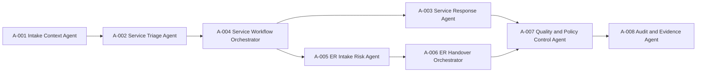
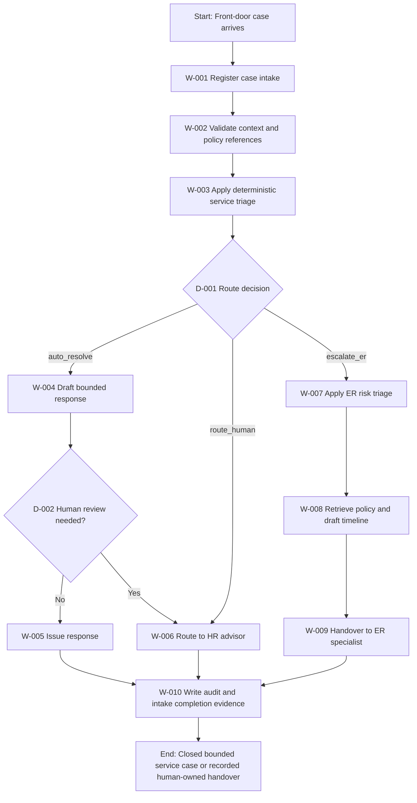

# Executive Summary

This Stage 4 deliverable classifies the Employee Service and ER IR Intake capability into a step-aligned agent model, with explicit control points, internal orchestration, handovers, and human interventions for each workflow step. The deliverable uses the Stage 4 methodology as primary authority and the Stage 3 decomposition as the factual baseline. [SRC-01, Objective to Outputs of Stage 4]; [SRC-02, sections 4 to 9]

Scope covers front-door case intake, deterministic service triage, bounded self-service response, ER risk triage, specialist handover, and audit completion evidence for the Manage Workforce Relations to Experience value stream. [SRC-03, Part 1 value stream table]; [SRC-03, section 6.4 Employee Service + ER/IR Intake Agents]; [SRC-02, sections 5 and 6]

Classification summary:

- Total capability agents defined: 8
- Classification mix:
  - Task: 5 agents
  - Insight: 2 agents
  - Orchestration: 2 agents
  - Control: 2 agents
  - Experience: 1 agent
- Workflow steps covered: 10 (W-001 to W-010)
- Control points defined: 10 (one per workflow step, minimum met) [SRC-01, activity 6]

ABBA reuse outcome summary:

- Reused unchanged: 0
- Adapted: 6
- Combined: 2
- No suitable asset: 0
- New design: 0

The dominant pattern is adaptation and combination of ABBA employee support and employee relations assets to fit the specific deterministic triage and ER no-auto-action boundary required by this capability. [SRC-04, lines 74-78, 275, 277, 286, 288, 317]; [SRC-03, section 6.4]

Principal constraints and open items remain unchanged from Stage 3: named ownership allocations, detailed SLA or retention values, and full downstream closure criteria for human-routed cases are still pending and are carried forward as explicit gaps and open questions. [SRC-02, sections 3.4, 9.2, 9.3]

# Overall AI Framework

## Capability Context

- Capability: Employee Service and Case Resolution
- Agent ID baseline: HR-MTS-001/002
- Autonomy boundary: L3 augmented, bounded self-service auto-resolution only, ER and non-standard routed to humans
- Deterministic cores in scope: triage_case and er_triage
- Human authority boundary: ER outcomes are always human-led

[SRC-03, section 6.4]; [SRC-03, tool catalogue lines 97-98]; [SRC-03, Human-in-the-loop boundary for Continuous Workforce Safeguarding]

## Agent Landscape

| Agent ID | Agent name | Primary purpose | Stage 4 classification | Type rationale | Evidence |
|---|---|---|---|---|---|
| A-001 | Intake Context Agent | Register, validate and structure front-door case context | Task | Performs structured intake and context preparation | [SRC-02, W01-W02]; [SRC-03, section 6.4 data schema] |
| A-002 | Service Triage Agent | Apply deterministic service triage for route decisions | Task, Insight | Executes deterministic decisioning and interprets route outcomes | [SRC-03, triage_case]; [SRC-02, W03, D01] |
| A-003 | Service Response Agent | Draft grounded bounded responses for eligible cases | Task, Experience | Produces bounded response and user-facing interaction quality | [SRC-03, section 6.4 generic script]; [SRC-02, W04-W05] |
| A-004 | Service Workflow Orchestrator | Coordinate service path transitions and handovers | Orchestration | Manages branch flow and assignment transitions | [SRC-02, W03-W06, H03-H05] |
| A-005 | ER Intake Risk Agent | Perform ER deterministic risk triage and flagging | Task, Insight | Classifies risk type, severity and flags | [SRC-03, er_triage]; [SRC-02, W07, D03] |
| A-006 | ER Handover Orchestrator | Assemble and transmit ER specialist intake pack | Orchestration | Coordinates ER pack and specialist routing | [SRC-02, W08-W09, H07] |
| A-007 | Quality and Policy Control Agent | Enforce control checks including low-confidence review and QA sampling | Control | Implements control policy gates across service and ER boundaries | [SRC-02, D02, D05, HIP-02, HIP-05] |
| A-008 | Audit and Evidence Agent | Write immutable action, decision and provenance trail | Control, Task | Ensures governance evidence completeness | [SRC-03, section 4.4 audit trail schema]; [SRC-02, W10, H08] |

## Internal Orchestration Model

Control architecture alignment:

- Deterministic route control sits at triage and ER risk classification.
- Human review controls are injected for low-confidence or sensitive service responses.
- Human specialist ownership is mandatory for all ER cases.
- QA sampling control is mandatory for auto-resolved service responses.
- Immutable audit evidence control closes every path.

[SRC-01, activity 6]; [SRC-03, governance and compliance controls for Continuous Workforce Safeguarding]; [SRC-02, D02, D05, HIP section]

## Deliverables Coverage Matrix

| Stage 4 mandatory deliverable item | Coverage in this document | Evidence |
|---|---|---|
| Agent inventory per workflow step | Workflow Decomposition Catalogue and Appendix B | [SRC-01, Outputs of Stage 4] |
| Agent classifications | Overall AI Framework and Appendix B | [SRC-01, activity 3] |
| Internal orchestration diagrams | Overall AI Framework and End-to-End Workflow | [SRC-01, activity 4] |
| Handovers to previous and next steps | Handover and Interaction Register | [SRC-01, activity 5] |
| Control point for every step | Workflow Decomposition Catalogue and control map | [SRC-01, activity 6] |
| Framework for every agent | Appendix A component frameworks | [SRC-01, activity 7] |
| ABBA reuse assessment and variance log | Appendix C reuse and variance log | [SRC-01, activity 8] |

# End-to-End Workflow

## Workflow Trigger

A case arrives at the front door from employee or manager channels. [SRC-03, section 6.4 generic script]; [SRC-02, section 5]

## Normal Flow

## Decision and Exception Routes

- D-001 selects auto_resolve, route_human or escalate_er via deterministic rules.
- D-002 checks low-confidence or sensitive response risk before issuance.
- D-003 determines ER risk type and severity with flag inspection.
- D-004 determines specialist or specialist-plus-counsel route.
- D-005 determines QA sampling for auto-resolved service cases.

[SRC-02, section 8.1]

# Workflow Decomposition Catalogue

| Workflow step ID | Step name | Step objective | Operation | Producing performer | Consuming performer | Business owner | Data owner | Data steward | Source system owner | Inputs | Outputs | Trigger | Related decisions | Related exceptions | Assigned agent | Agent type | Control point | Evidence |
|---|---|---|---|---|---|---|---|---|---|---|---|---|---|---|---|---|---|---|
| W-001 | Register front-door intake | Create a valid case intake record and initialise context | Create, Read, Validate | Employee or manager | Employee Service capability | HR Operations (TBC named owner) | HR data owner (TBC) | HR data steward (TBC) | Case system owner (TBC) | Query, identity, channel | Initial case record | Front-door case arrival | D-001 | E-005 | A-001 | Task | C-001 Embedded intake validation | [SRC-02, W01]; [SRC-03, section 6.4] |
| W-002 | Validate context and policy references | Ensure triage-ready case attributes and policy context are complete | Read, Validate, Update | A-001 | A-002 | HR Operations (TBC) | HR data owner (TBC) | HR data steward (TBC) | Knowledge base owner (TBC) | Case fields, policy context | Validated triage packet | W-001 completion | D-001 | E-005 | A-001 | Task | C-002 Deterministic completeness checks | [SRC-02, W02]; [SRC-03, data schema] |
| W-003 | Deterministic service triage | Route case to service auto-resolution, human service, or ER stream | Derive, Update | A-002 | A-004 | HR Operations (TBC) | HR data owner (TBC) | HR data steward (TBC) | Case system owner (TBC) | Triage-ready packet | Route decision | W-002 completion | D-001 | E-001, E-002 | A-002 | Task, Insight | C-003 Deterministic triage rule control | [SRC-03, triage_case]; [SRC-02, W03, D01] |
| W-004 | Draft bounded service response | Produce grounded, cited response for eligible bounded service cases | Read, Derive, Create | A-003 | A-007 | HR Operations (TBC) | HR data owner (TBC) | HR data steward (TBC) | Knowledge base owner (TBC) | Auto-resolve route and policy content | Draft bounded response with citations | D-001 auto_resolve | D-002 | E-003, E-005 | A-003 | Task, Experience | C-004 Grounding and sensitivity pre-check | [SRC-02, W04]; [SRC-03, deterministic-LLM boundary] |
| W-005 | Issue bounded response | Deliver response and update service case status | Transmit, Update, Create | A-003 | Employee or manager | HR Operations (TBC) | HR data owner (TBC) | HR data steward (TBC) | Case system owner (TBC) | Approved bounded response | Delivered response record | D-002 no review required | D-005 | E-003 | A-003 | Experience | C-005 Provenance issuance control | [SRC-02, W05]; [SRC-03, governance controls] |
| W-006 | Route service case to HR advisor | Transfer non-standard or high-priority service case to human owner | Transmit, Update | A-004 | HR advisor | HR Operations (TBC) | HR data owner (TBC) | HR data steward (TBC) | Case system owner (TBC) | Route-human decision or review trigger | Human handover packet | D-001 route_human or D-002 review required | D-005 | E-001, E-002, E-003 | A-004 | Orchestration | C-006 Human assignment acknowledgement | [SRC-02, W06, HIP-01] |
| W-007 | Apply ER risk triage | Classify ER risk type, severity, and flags | Read, Derive, Create, Update | A-005 | A-006 | ER Specialist function (TBC named owner) | ER data owner (TBC) | ER data steward (TBC) | ER system owner (TBC) | Escalated ER case context | ER risk classification | D-001 escalate_er | D-003, D-004 | E-004, E-005 | A-005 | Task, Insight | C-007 ER no-auto-action classification control | [SRC-03, er_triage]; [SRC-02, W07] |
| W-008 | Retrieve policy and draft ER timeline | Assemble policy basis and assistive timeline for specialist handling | Read, Derive, Create | A-006 | ER specialist or counsel path | ER Specialist function (TBC named owner) | ER data owner (TBC) | ER data steward (TBC) | Policy source owner (TBC) | ER triage output and policy references | ER policy pack and timeline | W-007 completion | D-004 | E-004, E-005 | A-006 | Orchestration | C-008 Human-determination boundary control | [SRC-02, W08]; [SRC-03, section 6.4 generic script] |
| W-009 | Handover ER case to specialist | Transfer complete ER intake artefact to human specialist owner | Transmit, Update | A-006 | ER specialist | ER Specialist function (TBC named owner) | ER data owner (TBC) | ER data steward (TBC) | ER system owner (TBC) | ER policy and triage artefacts | Specialist ownership record | W-008 completion | D-004 | E-004 | A-006 | Orchestration | C-009 Specialist acceptance control | [SRC-02, W09, HIP-03] |
| W-010 | Record audit and completion evidence | Write immutable action, decision and provenance record for all paths | Create, Update, Validate, Transmit | A-008 | Governance and audit record | Control owner (TBC) | Governance data owner (TBC) | Governance data steward (TBC) | Governance log owner (TBC) | Case path outputs from W-005, W-006, W-009 | Audit trail record and status evidence | Any terminal path output | D-005 | E-003, E-005 | A-008 | Control, Task | C-010 Audit completeness and immutability control | [SRC-03, section 4.4]; [SRC-02, W10] |

# Handover and Interaction Register

| Handover ID | Source | Destination | Information transferred | Producing performer | Consuming performer | Control owner | Preconditions | Postconditions | Failure mode | Evidence |
|---|---|---|---|---|---|---|---|---|---|---|
| H-001 | Employee or manager | A-001 | Query, identity context, channel metadata | Employee or manager | Intake Context Agent | HR Operations control owner (TBC) | Valid user request exists | Intake record created | Missing identity or malformed request | [SRC-02, H01] |
| H-002 | A-001 | A-002 | Validated case packet and policy references | Intake Context Agent | Service Triage Agent | HR Operations control owner (TBC) | Mandatory fields present | Deterministic triage executable | Missing category or policy context | [SRC-02, H02, W02-W03] |
| H-003 | A-004 | A-003 | Auto-resolve route, response context, policy citations | Service Workflow Orchestrator | Service Response Agent | Quality control owner (TBC) | D-001 is auto_resolve | Draft response produced | Out-of-scope request sent as auto-resolve | [SRC-02, H03, W04] |
| H-004 | A-004 | HR advisor | Human service handover packet and rationale | Service Workflow Orchestrator | HR advisor | HR Operations control owner (TBC) | D-001 route_human or D-002 review trigger | Human service ownership accepted | Assignment not acknowledged | [SRC-02, H04, HIP-01] |
| H-005 | A-004 | A-005 | ER escalation payload and context | Service Workflow Orchestrator | ER Intake Risk Agent | ER control owner (TBC) | D-001 escalate_er | ER triage initiated | Escalation context incomplete | [SRC-02, H05] |
| H-006 | Policy and legal sources | A-006 | Policy references and legal context inputs | Policy source | ER Handover Orchestrator | Policy control owner (TBC) | ER risk classification completed | Policy pack complete | Stale or missing policy source | [SRC-02, H06] |
| H-007 | A-006 | ER specialist | ER triage output, flags, policy pack, timeline draft | ER Handover Orchestrator | ER specialist | ER specialist control owner (TBC) | D-004 determined and artefacts complete | Specialist ownership recorded | Specialist handover delay or reject | [SRC-02, H07] |
| H-008 | A-003 or A-004 or A-006 | A-008 | Route history, evidence artefacts, outcome status | Service or ER capability agent | Audit and Evidence Agent | Governance control owner (TBC) | Terminal event exists | Immutable audit record written | Incomplete provenance or missing decision trail | [SRC-02, H08]; [SRC-03, section 4.4] |

# Decision Catalogue

| Decision ID | Decision name | Triggering step | Decision question | Decision logic or criteria | Required evidence | Decision owner | Approval requirement | Possible outcomes | Downstream impact | Evidence |
|---|---|---|---|---|---|---|---|---|---|---|
| D-001 | Service routing decision | W-003 | Should case be auto_resolve, route_human, or escalate_er? | Deterministic category, priority, SLA rule matrix | Case attributes and rule result | HR Operations policy owner (TBC) | No direct human approval for deterministic routing, but route_human and escalate_er lead to human-owned paths | auto_resolve, route_human, escalate_er | Selects W-004, W-006, or W-007 branch | [SRC-03, triage_case]; [SRC-02, D01] |
| D-002 | Response review decision | W-004 | Is human review required before issuing bounded response? | Sensitivity and low-confidence guardrails | Response draft, confidence proxy, sensitivity marker | QA or service reviewer owner (TBC) | Yes when flagged | Review required or not required | Sends to W-006 or W-005 | [SRC-02, D02, HIP-02] |
| D-003 | ER risk classification decision | W-007 | What ER risk class and severity apply? | Deterministic ER flag and severity logic | ER case content and flag evidence | ER Specialist policy owner (TBC) | No, but all outcomes remain human-owned later | Risk type and severity assigned | Determines policy retrieval and specialist routing context | [SRC-03, er_triage]; [SRC-02, D03] |
| D-004 | ER specialist path decision | W-008 or W-009 | Is specialist-only handling enough or is specialist-plus-counsel path needed? | Flag-based route criteria for legal or psychosocial exposure | ER flags and policy indicators | ER specialist owner (TBC) | Human specialist authority required | Specialist route or specialist-plus-counsel route | Determines final handover target context | [SRC-02, D04, HIP-04] |
| D-005 | QA sample decision | W-005 or W-010 | Should this auto-resolved case be sampled for QA? | QA sampling policy and selection rules | Response provenance and case metadata | QA control owner (TBC) | Human review when selected | Selected or not selected | Additional QA review evidence or direct completion record | [SRC-02, D05, HIP-05] |

# Exception Catalogue

| Exception ID | Exception name | Trigger condition | Affected steps | Severity or priority | Containment action | Escalation route | Resolution owner | Closure criteria | Evidence |
|---|---|---|---|---|---|---|---|---|---|
| E-001 | Ambiguous service categorisation | Triage cannot classify confidently | W-003, W-006 | High | Stop auto-resolution and route to HR advisor | HR advisor path | HR Operations exception owner (TBC) | Human ownership accepted and route reason logged | [SRC-02, EX-01] |
| E-002 | Non-standard or high-priority service case | Deterministic route indicates out-of-bounds service handling | W-003, W-006 | High | Human route with full context | HR advisor path | HR Operations exception owner (TBC) | Human handler assignment complete | [SRC-02, EX-02] |
| E-003 | Low-confidence or sensitive response | Draft response fails confidence or sensitivity threshold | W-004, W-005, W-006 | High | Trigger human review before issuance | HR advisor or reviewer path | QA reviewer owner (TBC) | Reviewer outcome recorded and case status updated | [SRC-02, EX-03] |
| E-004 | Flagged ER exposure | ER triage identifies union, psychosocial, or legal flags | W-007, W-008, W-009 | Critical | Immediate specialist handover with flag context | ER specialist and counsel path if indicated | ER specialist owner (TBC) | Specialist ownership and route evidence captured | [SRC-02, EX-04] |
| E-005 | Insufficient policy or context evidence | Policy or case evidence is incomplete for safe automated handling | W-002, W-004, W-007, W-010 | High | Block unsupported automation and route to human owner | HR advisor or ER specialist path | Policy source owner and operations owner (TBC) | Gap resolved or case moved to human-owned handling | [SRC-02, EX-05] |

# Human Intervention Points

| HIP ID | Human role | Trigger | Required action | Reason human judgement is needed | Input artefacts | Output artefacts | Approval or control linkage | Timing expectation | Evidence |
|---|---|---|---|---|---|---|---|---|---|
| HIP-001 | HR advisor | route_human service branch | Accept and handle non-standard service case | Non-standard or high-priority case requires contextual judgement | Handover packet and route rationale | Human case action record | Linked to C-006 | As soon as routed | [SRC-02, HIP-01] |
| HIP-002 | Human reviewer (TBC role) | Low-confidence or sensitive response | Review or reject response before issue | Safety, fairness and confidence controls | Draft response and citations | Review outcome record | Linked to C-004 | Prior to response issuance | [SRC-02, HIP-02] |
| HIP-003 | ER specialist | Any ER case handover | Take ownership and decide consequential action | ER determinations are explicitly human-led | ER triage output, policy pack, timeline | Specialist ownership and decision trail | Linked to C-009 | Immediate upon handover | [SRC-02, HIP-03]; [SRC-03, section 6.4] |
| HIP-004 | ER specialist or counsel | High-risk ER flags | Determine specialist-plus-counsel treatment | Legal and fairness exposure requires specialist judgement | Flagged ER case pack | Specialist routing outcome | Linked to C-009 | Immediate for flagged cases | [SRC-02, HIP-04] |
| HIP-005 | QA reviewer (TBC role) | QA sampling selected | Perform QA on auto-resolved response | Control assurance on bounded automation | Response record and provenance | QA review evidence | Linked to C-010 and D-005 | Scheduled per QA cadence | [SRC-02, HIP-05] |

# SME Validation and Confirmation

## Required Validation Participants

- Business SME for Employee Service and ER IR Intake
- HR Operations process owner
- ER Specialist representative
- Governance and controls reviewer
- Delivery and methodology reviewer

[SRC-02, section 9.1]; [SRC-01, Inputs from Stage 3]

## Validation Checklist

- Confirm step-level agent assignments and classifications (A-001 to A-008)
- Confirm each workflow step has one valid control point (C-001 to C-010)
- Confirm route and exception behaviour matches operational policy
- Confirm ownership mapping fields currently marked TBC
- Confirm ABBA reuse outcomes and adaptation rationale
- Confirm handover preconditions and failure modes are sufficient

## Validation Status

- Classification completeness: Draft complete, pending SME review
- Control-point completeness: Complete (10 of 10)
- Evidence traceability: Complete at section and row level
- Ownership completeness: Incomplete (named owners pending)
- Stage approval status: Pending

[SRC-02, sections 9.2 and 9.3]

# Stage 4 to Stage 5 Handover

The following artefacts are ready to hand over into Stage 5 modelling:

- Approved Stage 4 agent model and classification set (A-001 to A-008)
- Workflow Decomposition Catalogue (W-001 to W-010 with operations and control points)
- Handover and Interaction Register (H-001 to H-008)
- Decision Catalogue (D-001 to D-005)
- Exception Catalogue (E-001 to E-005)
- Human Intervention Points (HIP-001 to HIP-005)
- ABBA reuse assessment and variance log (Appendix C)
- Open assumptions, constraints, open questions and gaps (Appendices D to G)

Stage 5 focus areas inherited from unresolved items:

- Named ownership assignments
- Detailed policy and SLA parameterisation
- Retention and audit operational timings
- Human-routed downstream closure criteria

[SRC-01, Next stage]; [SRC-02, section 3.4 and Appendix C references]

# Appendices

## Appendix A - Component AI Frameworks (Per Agent)

### A-001 Intake Context Agent

- Purpose: Capture and validate front-door case intake with mandatory context.
- Inputs: Query, identity, channel, case metadata.
- Outputs: Validated intake packet.
- Behaviour: Register, validate completeness, normalise attributes.
- Exceptions: E-005 insufficient context.
- Controls: C-001, C-002.
- Human interaction: None in normal path; routes to human when evidence gaps exist.
- Evidence: [SRC-02, W01-W02]; [SRC-03, section 6.4]

### A-002 Service Triage Agent

- Purpose: Deterministically classify service route outcomes.
- Inputs: Validated case packet and policy rules.
- Outputs: Route decision.
- Behaviour: Execute triage_case and persist route rationale.
- Exceptions: E-001, E-002.
- Controls: C-003.
- Human interaction: Indirect, via route_human and escalate_er outcomes.
- Evidence: [SRC-03, triage_case]; [SRC-02, D01]

### A-003 Service Response Agent

- Purpose: Draft and deliver bounded service responses with provenance.
- Inputs: Auto-resolve decision, policy citations.
- Outputs: User-facing response and response evidence.
- Behaviour: Grounded drafting and issuance under control checks.
- Exceptions: E-003, E-005.
- Controls: C-004, C-005.
- Human interaction: HIP-002 when sensitivity or confidence triggers.
- Evidence: [SRC-03, section 6.4 generic script]; [SRC-02, W04-W05]

### A-004 Service Workflow Orchestrator

- Purpose: Coordinate service-path branch execution and handovers.
- Inputs: D-001 and D-002 outcomes.
- Outputs: Service route assignments and handover packets.
- Behaviour: Route to response agent, HR advisor, or ER intake agent.
- Exceptions: E-001, E-002, E-003.
- Controls: C-006.
- Human interaction: HIP-001 via HR advisor route.
- Evidence: [SRC-02, W03-W06, H04-H05]

### A-005 ER Intake Risk Agent

- Purpose: Classify ER cases by risk type, severity, and flags.
- Inputs: Escalated ER case.
- Outputs: ER classification artefact.
- Behaviour: Execute er_triage deterministically and persist flags.
- Exceptions: E-004, E-005.
- Controls: C-007.
- Human interaction: Enables HIP-003 and HIP-004 but does not decide outcomes.
- Evidence: [SRC-03, er_triage]; [SRC-02, W07, D03]

### A-006 ER Handover Orchestrator

- Purpose: Build ER policy pack and hand over to specialist owners.
- Inputs: ER classification artefact, policy references.
- Outputs: Specialist-ready handover pack.
- Behaviour: Retrieve policy, draft timeline, route to specialist.
- Exceptions: E-004, E-005.
- Controls: C-008, C-009.
- Human interaction: HIP-003 and HIP-004.
- Evidence: [SRC-03, section 6.4 generic script]; [SRC-02, W08-W09]

### A-007 Quality and Policy Control Agent

- Purpose: Enforce quality and policy controls across response and QA paths.
- Inputs: Response drafts, route metadata, sampling policy.
- Outputs: Review decision, QA selection decision.
- Behaviour: Evaluate review triggers and sample eligibility.
- Exceptions: E-003.
- Controls: C-004, C-010.
- Human interaction: HIP-002 and HIP-005.
- Evidence: [SRC-02, D02, D05, HIP-02, HIP-05]

### A-008 Audit and Evidence Agent

- Purpose: Create immutable audit, provenance, and completion records.
- Inputs: Terminal path outcomes and decision trail artefacts.
- Outputs: Audit-trail entry and completion evidence.
- Behaviour: Validate mandatory fields and persist audit schema.
- Exceptions: E-005.
- Controls: C-010.
- Human interaction: Governance review where gaps are identified.
- Evidence: [SRC-03, section 4.4]; [SRC-02, W10, H08]

## Appendix B - Agent Inventory by Workflow Step

| Workflow step | Agents in step | Control point | Human involvement |
|---|---|---|---|
| W-001 | A-001 | C-001 | None |
| W-002 | A-001 | C-002 | None |
| W-003 | A-002, A-004 | C-003 | None |
| W-004 | A-003, A-007 | C-004 | HIP-002 conditional |
| W-005 | A-003, A-007 | C-005 | HIP-005 conditional |
| W-006 | A-004 | C-006 | HIP-001 mandatory |
| W-007 | A-005 | C-007 | None |
| W-008 | A-006 | C-008 | HIP-004 conditional |
| W-009 | A-006 | C-009 | HIP-003 mandatory |
| W-010 | A-008, A-007 | C-010 | HIP-005 conditional |

## Appendix C - ABBA Reuse Assessment and Variance Log

| Candidate ABBA Agent ID | ABBA agent name | ABBA agent type | Capability relevance | Reuse outcome | Adaptation or combination required | Variance from requirement | Evidence |
|---|---|---|---|---|---|---|---|
| VA-1331 | HR inquiry responder | Task Agent | Front-door service query response | Adapted | Add deterministic bounded triage and citation guardrails | ABBA entry does not explicitly enforce bounded autonomy and ER boundary | [SRC-04, line 275]; [SRC-03, section 6.4] |
| VA-1333 | Support services workflow manager | Process Agent | Service workflow routing and handovers | Adapted | Add explicit branching for route_human and escalate_er | ABBA entry is broad workflow orchestration, not ER-specific boundary control | [SRC-04, line 277]; [SRC-02, W03-W07] |
| VA-1205 | Investigation case manager | Task Agent | ER case progression context | Adapted | Restrict to intake support and specialist handover preparation | ABBA entry implies full case management while this capability keeps ER determination human-led | [SRC-04, line 75]; [SRC-03, section 6.4] |
| VA-1208 | ER compliance monitor | Control Agent | ER controls and no-auto-action policy | Reused unchanged | No functional change required at control intent level | None | [SRC-04, line 78]; [SRC-03, governance controls] |
| VA-1204 | Policy analyser | Task or Control Agent | Policy retrieval and consistency checks | Combined | Combined with VA-1208 and VA-1205 behaviours into A-006 and A-007 | Policy analysis alone does not complete specialist handover and QA model | [SRC-04, line 74]; [SRC-02, W08] |
| VA-1207 | Employee relations specialist | Insight Agent | ER subject-matter risk interpretation support | Adapted | Use as specialist-support pattern only, not autonomous ownership | ABBA entry is specialist-oriented role, not deterministic triage-plus-human boundary implementation | [SRC-04, line 77]; [SRC-02, D03, HIP-03] |
| VA-1209 | ER experience agent | Experience Agent | Sensitive ER communication quality | Combined | Combined with A-003 and A-006 communication components | Experience focus alone insufficient for control and deterministic risk design | [SRC-04, line 286]; [SRC-02, HIP-03] |
| VA-1211 | Grievance processor | Task Agent | ER grievance pathway input | Adapted | Narrow to intake classification and specialist handover trigger | ABBA entry may imply end-to-end processing beyond Stage 4 boundary | [SRC-04, line 288]; [SRC-01, Practitioner guidance] |
| VA-1240 | Employee relations workflow manager | Process Agent | ER orchestration and specialist route control | Adapted | Add explicit no-auto-action boundary and deterministic evidence trail requirements | ABBA entry not explicit on mandatory no-auto-action and audit closure schema | [SRC-04, line 317]; [SRC-03, section 4.4] |

## Appendix D - Assumptions Register

| Assumption ID | Assumption | Reason required | Impact if incorrect | Evidence |
|---|---|---|---|---|
| ASM-001 | Stage 3 workflow steps W01-W10 remain current for Stage 4 classification | Required to complete Stage 4 from available material | Rework of decomposition and agent mapping | [SRC-02, sections 6 to 8] |
| ASM-002 | Control owner roles can remain role-based pending named assignments | Named owners not available in source pack | Governance sign-off remains pending | [SRC-02, section 3.4] |
| ASM-003 | ABBA candidates listed are representative and usable for adaptation assessment | Full enterprise catalogue is broad and multi-process | Reuse decision may change after SME process fit review | [SRC-04, lines 74-78, 275, 277, 286, 288, 317] |

## Appendix E - Constraints Register

| Constraint ID | Constraint | Effect on Stage 4 output | Evidence |
|---|---|---|---|
| CON-001 | Stage 4 scope is logical architecture, not technical solution design | No implementation architecture, model deployment, or runtime design provided | [SRC-01, Practitioner guidance] |
| CON-002 | Named owners, SLA values, retention timings not fully evidenced | Ownership and timing fields carry TBC status | [SRC-02, section 3.4] |
| CON-003 | Human-routed downstream closure criteria remain unresolved | Stage 4 ends at recorded handover and intake completion evidence | [SRC-02, TBC-07 references] |

## Appendix F - Open Questions Register

| Open question ID | Question | Why it matters | Proposed owner | Evidence |
|---|---|---|---|---|
| OQ-001 | Who are the named owners for business, data, stewardship, source systems, and controls? | Required for approval-ready governance | Capability governance lead | [SRC-02, TBC-05] |
| OQ-002 | What are client-specific triage thresholds and SLA rule values? | Determines deterministic route precision and control behaviour | HR Operations policy owner | [SRC-02, TBC-03] |
| OQ-003 | What are retention and escalation timing requirements for audit and handovers? | Determines control timeliness and compliance evidence quality | Records and governance owner | [SRC-02, TBC-04] |
| OQ-004 | What are formal closure criteria for human-routed service and ER cases? | Required for complete lifecycle modelling | HR Operations and ER process SME | [SRC-02, TBC-07] |

## Appendix G - Gap Register

| Gap ID | Missing item | Impacted sections | Resolution action | Evidence |
|---|---|---|---|---|
| GAP-001 | Named owner assignments | Workflow Decomposition Catalogue, handovers, controls | Populate named owners and update approval records | [SRC-02, ACO-04, TBC-05] |
| GAP-002 | Client-specific rule matrix for triage and SLA | D-001 criteria, exceptions, control points | Add approved rule matrix from policy authority | [SRC-02, ACO-03, TBC-03] |
| GAP-003 | Retention and escalation timings | Handover controls, audit controls, HIP timing | Add approved retention schedule and escalations | [SRC-02, TBC-04] |
| GAP-004 | Human-routed closure model | End-to-end state model, Stage 5 handover | Confirm closure states and evidence events | [SRC-02, TBC-07] |

## Appendix H - Source Register

| Source ID | Source file | Role in deliverable | Precedence |
|---|---|---|---|
| SRC-01 | Delivery-Control/Stage_4.md | Authoritative Stage 4 method, outputs, and quality criteria | 1 |
| SRC-02 | Stage 3 Output/Employee_Service_ER_IR_Intake_Agent_Stage3_Decompose.md | Step-level workflow, decisions, exceptions, handovers, HIPs, unresolved gaps | 2 |
| SRC-03 | Source Documents/HR_Capability_and_Full_Agent_Catalogue_v1.md | Capability model, deterministic tools, autonomy boundary, controls and scripts | 2 |
| SRC-04 | ABBA-Reuse-Agents/Annotated_Agents_H2RList.csv | Reuse candidate identification and adaptation rationale | 3 |
| SRC-05 | Source Documents/HR_Stage4_Instructions.md and Source Documents/HR_Stage4_Skills.md | Structural and section completeness guidance for review-ready Stage 4 output | 2 |
